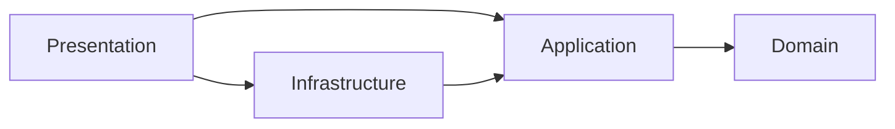

<h1 align="center">Clean Architecture .NET Template</h1>

<p align="center">
  The .NET 10 Clean Architecture template whose project is meant to be kept.
</p>

<p align="center">
  <a href="https://www.nuget.org/packages/CleanArch.WebApi.Templates"></a>
  <a href="https://www.nuget.org/packages/CleanArch.WebApi.Templates"></a>
  <a href="https://github.com/Pierre-MarieMarchio/cleanarch-dotnet/actions/workflows/ci.yml?query=branch%3Adevelop"></a>
  <a href="https://github.com/Pierre-MarieMarchio/cleanarch-dotnet/actions/workflows/template-acceptance.yml?query=branch%3Adevelop"></a>
  <a href="https://github.com/Pierre-MarieMarchio/cleanarch-dotnet/actions/workflows/codeql.yml?query=branch%3Adevelop"></a>
  <a href="https://dotnet.microsoft.com/download/dotnet/10.0"></a>
  <a href="LICENSE"></a>
  <a href="https://ko-fi.com/pmmarchio"></a>
</p>

A `dotnet new` template for a .NET 10 project on Clean Architecture: an HTTP API, or hosts with no
API, such as a Blazor portal, an MCP server, a desktop app or a worker. Its modules, mechanisms,
tests, tools and documentation are the ground a product grows on, and the options remove what a
product does not need.

## Quick start

```bash
mkdir acme-shop && cd acme-shop
dnx CleanArch.Create                    # names it AcmeShop, asks each option, generates here
dotnet tool restore
dotnet cleanarch bootstrap     # required once: commit what it changes
cp .env.example .env
docker compose up -d --build --wait
```

You need a .NET 10 SDK (10.0.100 or later), Docker with Compose v2 and about 5 GB of disk, mostly the
NuGet cache and the stack's images. Generating takes seconds; bootstrap and a first build about a
minute with a warm NuGet cache; the first `docker compose up --build` as long as the network takes
to pull its images. Those are orders of magnitude measured on one machine, not a promise.

With the default options, the API answers on <http://localhost:8080>, Scalar on
<http://localhost:8080/scalar/v1> and Mailpit on <http://localhost:8025>; a project generated
without the API lists its hosts' addresses in its first run page. The generated project's
[first run](docs/getting-started/first-run.md) continues to an authenticated call and a first
feature.

The launcher installs the templates and runs `dotnet new`, which works on its own as well:

```bash
dotnet new install CleanArch.WebApi.Templates
dotnet new cleanarch-webapi -n <Company.Product>
```

[Using the template](docs/template/using-the-template.md#install-and-uninstall) also installs the
`.nupkg` a GitHub Release attaches, a package packed locally, or this checkout; Visual Studio, Rider
and VS Code's C# Dev Kit then list the templates, with no extension.

## Inside a project

The generators and the gate are what the template offers once the project exists:

```bash
dotnet cleanarch add feature <Features> <Feature> --access owner --deletion delete  # a feature, its tests and its migration
dotnet cleanarch add use-case <Features> <UseCase> --kind command                   # one more operation on a feature
dotnet cleanarch add field <Features> "Code:string(20)='none'"                      # a field, down to its column
dotnet cleanarch add setting <Features> <Section> --keys "MaxItems:int(1..100)=10"  # a validated setting
dotnet cleanarch add event <Features> <Event> --unconsumed "<reason>"               # a domain event
dotnet cleanarch remove feature <Features>                                          # reports; --apply removes it
dotnet cleanarch migrations add <Name>                                               # a migration after a model change
dotnet cleanarch check                                                              # format, build and tests of what you touched
dotnet cleanarch verify                                                             # the whole gate, with Docker
dotnet cleanarch add web-app                                                                 # add a web app to the project
dotnet cleanarch add presentation                                                            # add a host to the project
```

`add feature` needs `--auth` other than `none`. [Adding a feature](docs/guides/adding-a-feature.md)
gives the steps, and [the project tool](docs/reference/cli.md) every command.

## What you get

| Area | What it is |
|---|---|
| **Architecture** | Four layers and the dependency rule, held by an architecture test suite: a domain, an application layer of use cases, infrastructure modules behind ports, a thin presentation layer. |
| **Features** | Two shapes, an aggregate when there is a state to protect and a service over a store when there is none, and a generator that writes either. |
| **Persistence** | EF Core on PostgreSQL, SQL Server or SQLite, chosen at generation, with the domain unmapped, optimistic concurrency exposed as `ETag`, and migrations applied at release. |
| **Authentication** | Local accounts with rotating refresh tokens, two-factor, passkeys and roles; an external OpenID Connect provider; or a public API. |
| **HTTP contract** | Problem documents with stable codes, default-deny authorisation, `Idempotency-Key`, offset and keyset paging, rate limits and timeouts, on every endpoint. |
| **Files, jobs, mail** | An S3-compatible file store with inspection and quotas; timers under leases, in the API process or in a worker; multilingual mail over SMTP or Postmark. |
| **Web apps** | A pnpm workspace with Vue, React, React Router, Svelte, Angular, Blazor WebAssembly or a static page, and a client generated from the API's own document. |
| **Gate** | Formatting, warnings as errors, the tests with a coverage floor, migration drift and vulnerable packages, run from a clone; CI, CodeQL, release and Sonar workflows. |
| **Documentation** | For the project, not the template: overview, first run, architecture, one page per feature, guides, references and ADRs, conditioned on the options chosen. |



Source dependencies point inward; [the architecture](docs/architecture/README.md) names the projects
of each layer and the tests that fail when one points the other way.

## Generation options

| Option | Values | Default |
|---|---|---|
| `--auth` | `local`, `external`, `none` | `local` |
| `--database` | `postgresql`, `sqlserver`, `sqlite` | `postgresql` |
| `--examples` | `all`, `notes`, `none` | `all` |
| `--files` | `true`, `false` | `true` |
| `--ci` | `true`, `false` | `true` |
| `--sonar` | `true`, `false` | `true` |
| `--agent-files` | `true`, `false` | `true` |
| `--agent-files-example` | `true`, `false` | `false` |
| `--aspire` | `true`, `false` | `false` |
| `--web` | `none`, `placeholder`, `vite-react`, `vite-vue`, `vite-svelte`, `react-router`, `angular`, `blazor-wasm` | `none` |
| `--web-name` | a PascalCase name, such as `Admin` | `Site` |
| `--web-audience` | `public`, `admin` | `public` |
| `--web-rendering` | `spa`, `ssr` | `spa` |
| `--presentation`, once per value | `api`, `blazor-server`, `mcp`, `avalonia`, `wpf`, `worker` | `api` |

`--presentation` names the hosts the project holds: the API, a Blazor portal, an MCP server, a
desktop app and a worker for the background jobs, which run in the API otherwise; a web app, a
desktop app or the MCP server under local accounts brings the API with it.

Some combinations are refused. `--auth none` refuses the examples and Files, which belong to a
caller, as well as `--web-audience admin` and `--presentation avalonia`, `wpf` and `mcp`;
`--web-rendering ssr` takes `--web angular` or `react-router`; `avalonia` and `wpf` refuse each
other; `worker` refuses `--database sqlite`; and a project holds the API, the worker or both: without
the API it gets the worker, which runs the background jobs.
[Using the template](docs/template/using-the-template.md) says what each value generates, the
combinations refused, what the name substitutes into, and the item templates `cleanarch-webapp`,
`cleanarch-webpackage` and `cleanarch-presentation`.

## Architectural decisions

The pages carry the reason of each part. An ADR is a last resort, kept for a significant,
costly-to-reverse choice between real alternatives: its context, the alternatives turned down, its
consequences and when to revisit it, so a team can keep or reverse it knowing what it costs.

- [The project's decisions](docs/decisions/README.md), which a generated project receives: a domain
  EF does not map, events after commit without an outbox, ownership in the query and the caller an
  MCP server acts for; the other choices are argued on the pages that describe each part.
- Why [Mediator](docs/decisions/0003-use-cases-are-mediator-messages-and-ports-are-explicit.md) and not
  MediatR, which has a commercial licence from version 13, and why
  [no AutoMapper](docs/architecture/layers-and-projects.md#mappings): a mapping resolved at run time
  is one a reader cannot follow, so mappings are written by hand.
- [The template's decisions](docs/template/README.md#its-decisions): why a project carries one
  database provider, why a pull request runs only the legs its change can affect, why a project runs
  its tasks from a pinned tool, and where a web app comes from.

## Documentation

This repository carries the documentation every generated project receives, in its fullest form:

- [The documentation index](docs/README.md): getting started, architecture, features, guides,
  reference and decisions.
- [AGENTS.md](AGENTS.md), [CONTRIBUTING.md](CONTRIBUTING.md) and [SECURITY.md](SECURITY.md), which a
  project receives too; `--agent-files false` leaves out `AGENTS.md`, the only agent file there is,
  and `--agent-files-example true` fills its closing section, the project team's own, with example
  lines about a made-up product in place of empty prompts.
- [CODE_OF_CONDUCT.md](CODE_OF_CONDUCT.md) and [SUPPORT.md](SUPPORT.md), which stay in this repository:
  the conduct it follows and where to ask a question or report a problem.

[The template documentation](docs/template/README.md) is about the template alone: using it,
maintaining it, its acceptance matrix and its own decisions. It never reaches a generated project.

## Roadmap

[The roadmap](docs/template/roadmap.md) lists what is coming, in order: more web apps from their
official generators, then presentation projects wired to the API or straight to the application
layer. It also says what the template leaves out on purpose, and how to propose an item.

## Support

Report a bug or ask for a feature through
[the repository's issue forms](https://github.com/Pierre-MarieMarchio/cleanarch-dotnet/issues/new/choose),
which ask for the version and the options generated with; report a vulnerability privately, in a
[security advisory](https://github.com/Pierre-MarieMarchio/cleanarch-dotnet/security/advisories/new).

## Support the project

The template is free and MIT-licensed. If it saves your team time, you can support its upkeep on
[Ko-fi](https://ko-fi.com/pmmarchio).

## Licence

MIT: see [LICENSE](LICENSE).
