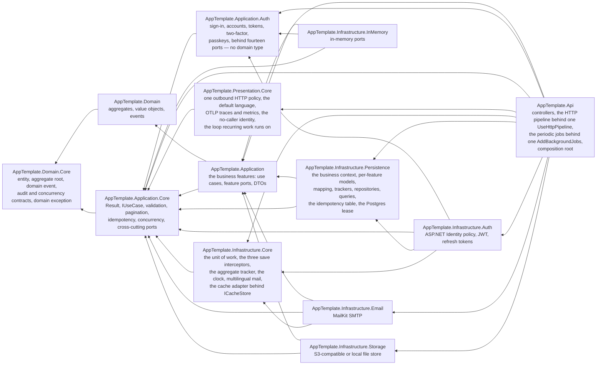

# Architecture

A Clean Architecture layout for a .NET 10 HTTP API. This document records the
decisions and, more usefully, the reasons — including the things this template
deliberately does **not** do.

The decisions this template already made, and the shape they impose, are in
[`DECISIONS.md`](DECISIONS.md) — each one held by a test where a test can hold it. This page is the
map; that document and the tests it names are the argument. Where the files themselves go is
[`PROJECT-LAYOUT.md`](PROJECT-LAYOUT.md).

**The shape**

- [The four layers and the dependency rule](#the-four-layers-and-the-dependency-rule)
- [Two feature shapes, chosen by one question](#two-feature-shapes-chosen-by-one-question)
- [Ports are named for business intent, not for technology](#ports-are-named-for-business-intent-not-for-technology)
- [Infrastructure is split per capability](#infrastructure-is-split-per-capability-with-no-per-technology-sub-split)
- [Background jobs in the API process](#background-jobs-in-the-api-process)
- [The HTTP boundary](#the-http-boundary)

**How the pieces behave**

- [Aggregates and domain events](#aggregates-and-domain-events)
- [Errors: `Result` for expected failures, exceptions for bugs](#errors-result-for-expected-failures-exceptions-for-bugs)
- [The transaction boundary, and who owns it](#the-transaction-boundary-and-who-owns-it)
- [Two contexts, one database, six schemas](#two-contexts-one-database-six-schemas)

**What is not here**

- [No MediatR, no CQRS ceremony](#no-mediatr-no-cqrs-ceremony)
- [No generic repository](#no-generic-repository)
- [What is deliberately absent](#what-is-deliberately-absent) — read this one before deciding the
  template forgot something

## The four layers and the dependency rule

Source dependencies point inward, always. Nothing in an inner layer knows an outer
one exists.

| Layer | Project(s) | Contains | May reference |
|---|---|---|---|
| Domain | `AppTemplate.Domain.Core` | the primitives an aggregate is built from: entity, aggregate root, domain event, the audit and concurrency contracts, the domain exception, and `UserId` — who a thing belongs to | **nothing** |
| Domain | `AppTemplate.Domain` | aggregates, value objects, domain events, invariants | `AppTemplate.Domain.Core` |
| Application | `AppTemplate.Application.Core` | the mechanisms a use case is written *from*: `Result`/`Error`, the `IUseCase` marker, validation, offset and cursor pagination, idempotency, optimistic concurrency, the cross-cutting ports | `AppTemplate.Domain.Core` |
| Application | `AppTemplate.Application` | the business features' use cases, feature ports, DTOs, validators | `AppTemplate.Domain` + `AppTemplate.Application.Core` |
<!--#if (localAuth)-->
| Application | `AppTemplate.Application.Auth` | authentication and account administration as use cases, behind fourteen ports; it names no aggregate, and the one domain type it names is `UserId` | `AppTemplate.Application.Core` |
<!--#endif-->
| Infrastructure | `AppTemplate.Infrastructure.Core` | the mechanisms a module needs and no module owns: what a context saves through — the unit of work, the three interceptors, the aggregate tracker — plus the system clock, multilingual mail rendered from a module's own embedded templates, and a cache behind a port | `AppTemplate.Application.Core` |
<!--#if (localAuth && files)-->
| Infrastructure | `AppTemplate.Infrastructure.Persistence`, `.Auth`, `.Email`, `.Storage`, `.InMemory` | EF Core, PostgreSQL, ASP.NET Identity, JWT, SMTP | the application projects it needs (→ Domain) + `AppTemplate.Infrastructure.Core` |
<!--#elseif (localAuth)-->
| Infrastructure | `AppTemplate.Infrastructure.Persistence`, `.Auth`, `.Email`, `.InMemory` | EF Core, PostgreSQL, ASP.NET Identity, JWT, SMTP | the application projects it needs (→ Domain) + `AppTemplate.Infrastructure.Core` |
<!--#elseif (files)-->
| Infrastructure | `AppTemplate.Infrastructure.Persistence`, `.Email`, `.Storage`, `.InMemory` | EF Core, PostgreSQL, SMTP | the application projects it needs (→ Domain) + `AppTemplate.Infrastructure.Core` |
<!--#else
| Infrastructure | `AppTemplate.Infrastructure.Persistence`, `.Email`, `.InMemory` | EF Core, PostgreSQL, SMTP | the application projects it needs (→ Domain) + `AppTemplate.Infrastructure.Core` |
#endif-->
| Presentation | `AppTemplate.Presentation.Core` | what any host needs whatever its transport: one outbound HTTP policy, the language a flow is written in, OTLP traces and metrics, the identity of a process with no caller — and no framework reference, deliberately | `AppTemplate.Application.Core` |
| Presentation | `AppTemplate.Api` | controllers, the periodic background jobs, composition root, host concerns; the API also holds the HTTP mechanisms no feature owns under `Common/` — the whole pipeline behind one `UseHttpPipeline()`: problem details, ETags, idempotency, rate limiting, CORS, security headers, versioning, the health endpoints — and a `FrameworkReference` on ASP.NET Core | `AppTemplate.Presentation.Core` + the application projects it needs + the modules that host needs |

The graph below is the template's own full shape, generated with every option on; this project's
own composition is the list of calls further down, and the projects its solution actually holds are
the ones `README.md` names.



<!--#if (localAuth)-->
**Authentication is never carried transitively.** Nothing in `AppTemplate.Application.Core` and
nothing in `AppTemplate.Application` names `AppTemplate.Application.Auth`, so a project that needs
it declares it: the identity module, the in-memory doubles, and the host. `AppTemplate.Infrastructure.Auth`
declares no arrow to `AppTemplate.Application` at all — it implements ten Auth ports and nothing
else.
<!--#endif-->

`AppTemplate.Application.Core` is drawn by twelve arrows rather than reached through one, and that
is the point of it: nothing carries it transitively as a favour. Every project that names a
`Result`, an `IUseCase` or a cross-cutting port declares the reference itself, so removing a
business project or a module never silently takes the mechanisms with it.

The domain having **no packages at all** is the load-bearing constraint. It is what makes the
domain testable with no host, no database and no mocking framework, and it is the first thing to
check in review. Verified: `AppTemplate.Domain.Core.csproj` declares no `ProjectReference` and no
runtime `PackageReference` — its single `PackageReference` is an analyzer, `PrivateAssets="all"`,
so nothing of it reaches the compiled assembly — and `AppTemplate.Domain.csproj` declares the one
`ProjectReference` to it and nothing else. An architecture rule holds the first half, because a
dependency taken by the innermost project is a dependency taken by every project above it.

`AppTemplate.Domain.Core` is the primitives an aggregate is built from, vendored rather than
published. That is what its shape is for. `CS1591` is re-enabled in that project alone, because a
derived project reads those signatures rather than the code behind them. It carries no version, because a project that
needs a primitive this one lacks copies the project and tunes it. The whole point of the division
is what it leaves for a derived project to write: its own `Features/`, plus whatever its own
features come to share as business.

**Two folders share a name, and one question sorts between them.** `<Layer>.Core/Common/` is the
agnostic half of a layer — `Result`, `Error`, `PageRequest`, `SortOrder`, `IUnitOfWork`,
`ICurrentUser`, `AggregateRoot<TId>`, `IDomainEvent`, `UserId` — and nothing in it may know a
feature; `<Layer>/Common/` is the business-shared half, what several features share *as business*.
The sorting test is one question — **does it know a feature?** — and
<!--#if (tagging)-->
[`PROJECT-LAYOUT.md`](PROJECT-LAYOUT.md#two-folders-called-common) holds the rule, the worked
example (`Common/Tagging/`, in both business layers) and the vocabulary test that holds both
folders.
<!--#else-->
[`PROJECT-LAYOUT.md`](PROJECT-LAYOUT.md#two-folders-called-common) holds the rule and the
vocabulary test that holds both folders.
<!--#endif-->

`AppTemplate.Application.Core` is the same shape one layer out, and it holds the application layer's
*mechanisms* rather than any of its business: `Result` and `Error`, the `IUseCase` marker every
named interface derives from, validation, offset and cursor pagination, idempotency, optimistic
concurrency, and the cross-cutting ports a host has to satisfy. It references
`AppTemplate.Domain.Core` and nothing else — never `AppTemplate.Domain`, because the two files here
that need a domain type, `IDomainEventConsumer` and `DomainGuard`, need only the primitives — so
this project knows no aggregate and cannot come to know one. It carries the same shape for the
same reasons: `CS1591` re-enabled so every public member owes a sentence to the reader who reads
signatures instead of code, and no version, because a project that needs a
mechanism this one lacks copies it and tunes it.
<!--#if (anyFeature)-->
Its two use cases are
`Features/Maintenance/UseCases/Commands/PurgeExpiredIdempotencyKeys/`, the idempotency
mechanism's own housekeeping, which names no business type, and
`Features/DeletedAccounts/UseCases/Commands/SweepDeletedAccountData/`, the leased sweep of the data of
accounts that are gone; a host opts into them with `AddPurgeExpiredIdempotencyKeys()` and
`AddDeletedAccountSweep()`, so one that has neither a maintenance endpoint nor a maintenance loop
is not made to supply the ports they resolve.
<!--#else
Its use case is `Features/Maintenance/UseCases/Commands/PurgeExpiredIdempotencyKeys/`, the
idempotency mechanism's own housekeeping, which names no business type; a host opts into it with
`AddPurgeExpiredIdempotencyKeys()`, so one that has neither a maintenance endpoint nor a
maintenance loop is not made to supply the ports it resolves.
#endif-->
<!--#if (publicApi)-->
The idempotency purge is reached through the API's maintenance job, whose interval is
configuration. There is deliberately no
<!--#else-->
The idempotency purge is reachable two
ways in this template: `MaintenanceController`, for a scheduler outside the process, and the
API's maintenance job, whose interval is configuration. There is deliberately no
<!--#endif-->
`AddApplicationCore()` beside it: this project declares ports, results and markers, none of which
anything registers, and an umbrella call that registered nothing would read like the seam that
makes the project work.

<!--#if (localAuth)-->
`AppTemplate.Application.Auth` is the layer's third project, and it is a vertical rather than a
Core: authentication and account administration as use cases — sign-in, refresh-token rotation, the
password and email lifecycle, two-factor enrolment, passkey ceremonies, external providers, roles and lockouts — under
six features — `Accounts`, `Sessions`, `TwoFactor`, `Passkeys`, `ExternalLogins`, `SecurityEvents` —
each `Features/<Feature>/{UseCases,Ports,Model}`. It declares one project reference,
`AppTemplate.Application.Core`, and it names **no aggregate**: the identity model is not one here,
it lives behind the fourteen ports in the features' `Ports/` folders. The one domain type it names is
`UserId`, which arrives through `ICurrentUser` — and every one of its own fourteen ports takes the
raw `Guid` inside it instead, because what an account is identified by here is the subject a token
carries rather than the business's notion of an owner. That is why the unwrap is visible at each of
those calls. It has a project of its own because it
is the part of this template a derived application is most likely to replace wholesale with its own
identity provider, and that is only possible if nothing composes it on that application's behalf —
hence one call, `AddAuthApplication()`, and no arrow to it from either of the other two application
projects. It is shaped like the two `.Core` projects for the same reasons: `CS1591` re-enabled, and no
version.
<!--#endif-->

`AppTemplate.Presentation.Core` is the presentation layer's fourth `.Core` and the outermost of
them: what any host needs whatever its transport, and nothing that names one. Five subjects, one
file each — the outbound HTTP policy installed on `IHttpClientFactory`'s defaults, the
`LocalizationOptions` naming the language a flow is written in when nobody said which to read, the
`TelemetryOptions` and the OTLP tracer and meter over it, `NoCallerCurrentUser`, the answer a
process with no request gives to "who is calling", and `PeriodicJob`, the loop a host's recurring
work is written on — see the background jobs below for what that primitive does and does not decide. It
declares one project reference, `AppTemplate.Application.Core`, and it is shaped like the three projects inwards for the same reasons: `CS1591` re-enabled so a
derived project can read the signatures instead of the code, and no version, because it is vendored and meant to be tuned where it lands.

**It carries no `FrameworkReference`, and that is why it is a project of its own rather than half of
one presentation Core.** A host with no HTTP surface — a desktop client, a CLI — gets a clock, a
culture and an outbound budget from it without inheriting ASP.NET, which is the door the split
exists to keep open; `AppTemplate.Api` is where everything that does need the framework goes.
Four packages this repository uses are therefore deliberately absent here, each because its own
nuspec carries that framework reference and would pull the shared framework in through the back
door: `Scalar.AspNetCore`, `Microsoft.AspNetCore.OpenApi`,
`OpenTelemetry.Instrumentation.AspNetCore`, and `Asp.Versioning.Mvc` through its dependency
`Asp.Versioning.Http`, whose own nuspec is clean, which is what makes that one hard to see.

**The portability is checked for everything under the HTTP host, not only for this project.**
`PortabilityTests` reads the project files and their `ProjectReference` closure and fails if the
domain, the application, the infrastructure projects or `AppTemplate.Presentation.Core` declare the
<!--#if (localAuth)-->
ASP.NET shared framework, use the Web SDK or reference an ASP.NET Core package. The one exemption is
`AppTemplate.Infrastructure.Auth`, whose `Microsoft.AspNetCore.Authentication.JwtBearer` is the
bearer-token handler of the ASP.NET authentication pipeline and carries the framework in its own
nuspec; the test names it with that reason and fails if the reason stops being true.
<!--#else-->
ASP.NET shared framework, use the Web SDK or reference an ASP.NET Core package. It exempts none of
them; an exemption would have to be named in the test with its reason, which the test checks stays
true.
<!--#endif-->

**One telemetry registration, and three things it takes from the host rather than deciding.** This
is the first question a reader has about a shared `AddObservability` — then how does each host get
its own spans? — and each of the three answers is forced rather than preferred.

- **The service name is the host's**, which is why the call takes an `Assembly` and not a string:
  `service.name` and `service.version` are read off it, so a rename or a version bump cannot leave a
  stale literal behind. Reading the shared project's own assembly would make every host announce
  itself under one name, and two processes reporting as one is worse than either reporting
  nothing. `TelemetryOptions.ServiceName` overrides it when several deployments share a collector.
- **The diagnostics names are the host's.** A host's `ActivitySource` and `Meter` names are
  constants on classes in its own feature folders, so a shared project that listed them would have
  to reference the host that references it — a project cycle no visibility change resolves. They
  arrive instead through two callbacks, `Action<TracerProviderBuilder>` and
  `Action<MeterProviderBuilder>`, invoked before the exporter so a host can still add a processor.
- **ASP.NET Core and Npgsql instrumentation are the host's**, for the two reasons above about
  packages: the first would need the framework reference this project refuses, and the second pulls
  the PostgreSQL driver, which would put a database behind every presentation host including a
  desktop one.

So a host keeps a thin extension of its own over the shared one, and it holds exactly what only
that host can say. `AppTemplate.Api`'s `Common/Observability/ObservabilityExtensions.cs` adds the
ASP.NET Core instrumentation, `AddNpgsql()`, the `Npgsql` and `Microsoft.AspNetCore.RateLimiting`
meters, and the one request-log entry that ties a caller's `traceId` to a span. The jobs add their
own to that same pipeline from `Features/BackgroundJobs/Jobs/BackgroundJobsTelemetry.cs`: each job's
sources and meters.
<!--#if (reminders)-->
The reminder meter is named through `PersistenceModule.RemindersMeterName`, because Common may not
name a feature, so that registration sits
beside the jobs rather than in `Common/Observability/`.
<!--#endif-->
It runs only when telemetry is enabled
and the jobs do. What is shared is the resource, the sampler, the outbound-HTTP instrumentation, the
runtime meters and the exporter — every part of the registration where two hosts disagreeing would
be a bug rather than a difference.

**Localisation binds in one place and is applied by the host**, on the same principle. The shared
`AddLocalizationOptions()` binds and validates the section and stops there; reading the bound value
into `CurrentLanguage.Default` is left to the host, because *when* that happens is a host's own
question. The API does it as the request pipeline is built, so the ambient default is in place
before the first request and before the first job pass, and every mail a job sends is written in it;
a process with only background work would do it once the container exists and before the first loop
runs. Doing it in the shared call would pick one of those for both.

Two rules that a compiler cannot state on its own, so state them here:

- **Modules reference `Persistence`, never the reverse.** `Persistence` owns the
  mechanics of saving; it must not know which capabilities exist.
- **Modules do not reference each other.** Anything two modules both need belongs in
  Application (as a port), in `AppTemplate.Infrastructure.Core` (as an agnostic mechanism), or in
  Persistence (as mechanics). `InfrastructureModules_ReferenceOnlyPersistenceHorizontally` is the
  rule, and it permits exactly those two horizontal edges — `Persistence`, and the layer's own
  SDK half — while asserting that both are really taken, so neither permission can
  quietly become a hole nothing uses.

Direction is enforced by the project graph, and is worth an architecture test —
`NetArchTest.Rules` is pinned in `Directory.Packages.props` for exactly that — so a
casual `using` cannot quietly invert it.

## Two feature shapes, chosen by one question

**Does the feature have rules that protect a state?** A forbidden transition, uniqueness within a
collection, a cap, a consistency between fields. The answer decides the shape, and nothing else does.

| | Simple feature (no state to protect) | Rich feature (state to protect) |
|---|---|---|
<!--#if (todoLists)-->
| Example | `Notes` | `TodoLists` (and `Reminders`; `Files` too where kept) |
<!--#elseif (notes)-->
| Example | `Notes` | — |
<!--#elseif (files)-->
| Example | — | `Files` |
<!--#else
| Example | — none ships | — none ships |
#endif-->
| Domain | nothing | aggregate, value objects, events |
| Application | one service (`INoteService`, one method per operation) over a store port and a queries port | one use case per operation, a repository port in the domain, a queries port |
| Persistence | the EF record is the model; the store projects to DTOs | record, mapper and tracker, so the domain stays free of EF |
| Validation | FluentValidation | FluentValidation, and the domain's invariants |
| Commit | `IUnitOfWork` | `IUnitOfWork`, the same boundary |

Both shapes are first-class; neither is the old way or the shortcut. A feature with no rule to
protect that is given an aggregate pays for a mapper, a tracker and a repository to guard nothing,
and one with a rule that is given a service has nowhere to put it.
[`ADDING-A-FEATURE.md`](ADDING-A-FEATURE.md#choose-the-shape-first) walks through both, and through
the way from the first to the second.

What the simple shape keeps is everything that is not the aggregate:

<!--#if (notes)-->
- **CQS holds.** A service with separate read and write methods is sufficient: the reads stage and
  commit nothing, and two models are not required. `Notes` splits its storage into `INoteQueries`
  (the reads) and `INoteStore` (the writes) because a port is one capability and staging is not
  reading, not because a read model is needed.
- **The commit is the same one.** A note is staged through `INoteStore` and committed by
  `IUnitOfWork`, with no mapper, no tracker and no domain-event source. The business context's
  interceptors (flush, audit, event dispatch) find nothing of a note to act on: its record is not
  `IAuditable` and no tracker holds it.
- **The owner is the caller.** It comes from `ICurrentUser`, never from the body, and every store
  and queries method names it, so somebody else's note and a missing one are the same answer.
- **A stale write is refused by the database.** The note's `xmin` is its concurrency token, read
  with the representation and published as the `ETag`. An update or delete loads the owner's row,
  compares the caller's `If-Match` against it (`412` when stale) and stages the change; EF then
  writes `UPDATE … WHERE "Id" = @id AND xmin = @loaded`, so a writer that loses a race between the
  load and the commit matches no row, `EfUnitOfWork` reports the conflict and the API answers `409`
  `concurrency.conflict`. The database, not the earlier read, has the last word.
- **The modular rule is unchanged.** `Notes` reaches no other feature and none reaches it.
<!--#else
- **CQS holds.** A service with separate read and write methods is sufficient: the reads stage and
  commit nothing, and two models are not required. The store and queries ports are separate because
  a port is one capability and staging is not reading.
- **The commit is the same one.** A record is staged through its store and committed by
  `IUnitOfWork`, with no mapper, no tracker and no domain-event source.
- **The owner is the caller.** It comes from `ICurrentUser`, never from the body, and every store
  and queries method names it, so somebody else's row and a missing one are the same answer.
- **A stale write is refused by the database.** Where the feature keeps one, the record's `xmin` is
  its concurrency token, read with the representation and published as the `ETag`, and a writer
  that loses a race matches no row at commit: the database, not the earlier read, has the last word.
- **The modular rule is unchanged.** A simple feature reaches no other feature and none reaches it.
#endif-->

`FeatureIsolationTests.AFeatureWithoutADomainFolder_IsAServiceOverAStore` is where the shape is
held: a feature may omit its domain folder only while it is a service over its storage ports (a store
to write, queries to read), with no use cases. A feature that grows a rule moves to the rich shape and the exemption stops applying to it.

## Ports are named for business intent, not for technology

A port is an interface **implemented in Infrastructure**, and its name says what the
caller needs, not what supplies it — but the two families of port are not declared in
the same layer. A **repository** — an aggregate loaded, mutated through its own
behaviour, and staged for a commit someone else owns — is declared in
**`AppTemplate.Domain`**, under `Features/<Feature>/Repositories/`, because its
signature names only domain types. **Every other port** — a read projected to DTOs, or
a platform capability with no aggregate behind it — is declared in the application layer, and which
of its projects declares one follows how many features need it. A port **one feature** reaches
for is declared in **`AppTemplate.Application`**, under `Features/<Feature>/Ports/<Port>/`.
<!--#if (localAuth)-->
A port of the authentication features is declared in **`AppTemplate.Application.Auth`**, under
`Features/<Feature>/Ports/<Port>/` of the one of its six features that owns the intent — the table
names it beside the project.
<!--#endif-->
A **cross-cutting** one, that any feature may reach for, is declared in
**`AppTemplate.Application.Core`** — in `Common/Ports/`, or beside its own subject when it has one,
which is why `IIdempotencyStore` sits in `Common/Idempotency/` with the key, the claim and the
status it speaks in. See the section above for why the
split runs there rather than putting every port in one layer:

| Port | Declared in | Implementation (Infrastructure) |
|---|---|---|
<!--#if (todoLists || reminders)-->
<!--#if (todoLists)-->
| `ITodoListRepository` | `AppTemplate.Domain` | EF Core repositories over `AppDbContext` |
<!--#endif-->
<!--#if (reminders)-->
| `IReminderRepository` | `AppTemplate.Domain` | EF Core repositories over `AppDbContext` |
<!--#endif-->
<!--#if (todoLists)-->
| `ITodoListQueries`, `ITodoItemQueries` | `AppTemplate.Application` | EF Core projections to DTOs |
<!--#endif-->
<!--#if (reminders)-->
| `IReminderQueries` | `AppTemplate.Application` | EF Core projections to DTOs |
<!--#endif-->
<!--#endif-->
| `IUnitOfWork` | `AppTemplate.Application.Core` | one `SaveChangesAsync` on `AppDbContext` |
| `IEmailSender` | `AppTemplate.Application.Core` | `MailKitEmailSender` |
| `ICurrentUser` | `AppTemplate.Application.Core` | `CurrentUser`, reading `HttpContext` claims |
| `IDateTimeProvider` | `AppTemplate.Application.Core` | `SystemDateTimeProvider` |
| `ILeaderLease` | `AppTemplate.Application.Core` | `PostgresLeaderLease`, a session-level advisory lock |
| `IIdempotencyStore` | `AppTemplate.Application.Core` | `IdempotencyStore`, the claim/complete/release state machine over one table |
| `ICacheStore` | `AppTemplate.Application.Core` | `HybridCacheStore`, in process until a deployment registers a distributed second level |
<!--#if (localAuth)-->
| `IAccountsService` | `AppTemplate.Application.Auth`, `Accounts` | `UserManager` / `SignInManager`: create, verify a password, may-sign-in, change password, read the profile |
| `IEmailTokensService` | `AppTemplate.Application.Auth`, `Accounts` | ASP.NET Identity's token providers: confirmation, password reset, email change |
| `ISessionTokensService` | `AppTemplate.Application.Auth`, `Sessions` | signed JWT over the account's current claims, and opaque rotating grants over `IRefreshTokenTable`, one refresh-token family per session |
| `ISessionsService` | `AppTemplate.Application.Auth`, `Sessions` | a session list its owner reads and ends, over `IRefreshTokenFamilyTable` |
| `ICurrentSession` | `AppTemplate.Application.Auth`, `Sessions` | `CurrentSession`, reading the token's `sid` claim and the request's `User-Agent` |
| `ITwoFactorService` | `AppTemplate.Application.Auth`, `TwoFactor` | Identity's authenticator plumbing, and the sign-in challenge in its token store |
| `IPasskeyService` | `AppTemplate.Application.Auth`, `Passkeys` | Identity's WebAuthn ceremonies over `IPasskeyHandler`, the credential rows over `UserManager`, and the single use of each ceremony state over `ISpentPasskeyCeremonyTable` |
| `IReAuthenticationService` | `AppTemplate.Application.Auth`, `Accounts` | `UserManager`: the account's password, or its armed second factor, checked again before an irreversible operation — no lockout counted, no stamp rotated |
| `IAccountAdministrationService` | `AppTemplate.Application.Auth`, `Accounts` | lock, unlock, roles, two-factor removal and deletion, over `UserManager` |
| `IExternalIdentityVerifier` | `AppTemplate.Application.Auth`, `ExternalLogins` | an `id_token` checked against a provider's JWKS |
| `IExternalLoginsService` | `AppTemplate.Application.Auth`, `ExternalLogins` | the `(provider, subject)` link, over ASP.NET Identity |
| `IAccountEmailFactory` | `AppTemplate.Application.Auth`, `Accounts` | HTML templates plus each link's page |
| `ISecurityEventLog` | `AppTemplate.Application.Auth`, `SecurityEvents` | structured log entries, plus the trail persisted in the identity schema and its retention purge |
| `ISecurityEventQueries` | `AppTemplate.Application.Auth`, `SecurityEvents` | one account's persisted trail, read back a page at a time |
<!--#endif-->

There is no `IEfCoreRepository`, no `ISmtpClient`, no `IHttpContextWrapper`. The
point of the seam is that the application layer can be read, and tested, without
knowing that EF Core, MailKit or an identity framework exist. A port named after its
implementation has already given that away.

<!--#if (localAuth)-->
The authentication ports are the interesting ones. There are fourteen of them, one per
intent, rather than one `IAuthService`, and the split is what keeps the
*sequencing* in Application: `RegisterUseCase` creates the account, then mints a
confirmation token, then composes and sends the mail through `IEmailSender`, and
decides that a delivery failure is a success carrying `confirmationEmailSent: false`.
`RefreshAccessTokenUseCase` rotates the presented grant, then revalidates the
account, then revokes the whole family if it may no longer sign in. Each port is one
intent an adapter can satisfy on its own, and none declares more than six operations,
and the ASP.NET Identity types (`AppUser`, `UserManager<>`) never appear in
Application. An architecture test asserts that no port grows wide enough to take the
sequencing back. Because those fourteen ports are all `AppTemplate.Application.Auth` speaks in, that
project names no aggregate: an account here is what its ports say about it. One of
them, `ICurrentSession`, names which session a request is made from, and only the host
can satisfy it — it sees the request — the same licence `ICurrentUser` has.
<!--#endif-->

## Infrastructure is split per capability, with no per-technology sub-split

Each capability gets one project, one DI extension method, and — where it needs
storage — one DbContext over the schemas it owns:

| Module | Registers | Storage |
|---|---|---|
| `AppTemplate.Infrastructure.Persistence` | `AppDbContext`, `IUnitOfWork`, `ILeaderLease`, the aggregate repositories and read-side ports, the idempotency store | `AppDbContext` → one schema per business feature, plus `platform` |
<!--#if (localAuth)-->
| `AppTemplate.Infrastructure.Auth` | the authentication ports, ASP.NET Identity, JWT bearer, refresh-token rotation, `IRefreshTokenTable`, `IIdentitySeeder` | `AuthDbContext` → `identity` |
<!--#endif-->
<!--#if (reminders)-->
| `AppTemplate.Infrastructure.Email` | `IEmailSender`, `IReminderNotifier`, email options | — |
<!--#else
| `AppTemplate.Infrastructure.Email` | `IEmailSender`, email options | — |
#endif-->
<!--#if (files)-->
| `AppTemplate.Infrastructure.Storage` | `IFileContentStore`, `IFileDirectTransfer`, `IFileContentInventory`, `IFileContentScanner`, the `Files:Storage` and `Files:Scanning` options, and the checks of `Files:Categories` against them | an S3-compatible bucket or a local directory, chosen by `Files:Storage:Provider` |
<!--#endif-->
| `AppTemplate.Infrastructure.InMemory` | in-memory port implementations for tests and demos | — |

**`AppTemplate.Infrastructure.Core` is not in that table, because it is not a capability.** It is
the layer's agnostic half: the mechanisms a module needs and no module owns. A module may not
reference a sibling, so without it two modules needing one mechanism have nowhere to put it and each
keeps a copy. Multilingual mail rendering is the case that pays for the project:
<!--#if (localAuth)-->
the identity module and the email module both send mail, so each would otherwise carry its own
renderer.
<!--#else
the email module sends mail, and the renderer sits here so the next module that sends mail takes
it rather than growing a copy of its own.
#endif-->

It holds three subjects. **What a context saves through** — `EfUnitOfWork` over whichever
`DbContext` a module owns, three interceptors a context attaches as its rows need them (aggregates
flushed onto their rows, rows stamped, the events that flush raised collected for after the
commit), and the `AggregateTracker` base every feature's tracker derives from. **The system
clock**, behind `IDateTimeProvider`. And the mail engine, `EmailTemplate`, which renders a
module's *own* embedded resources and reads the subject out of the template so a caller never
states it twice; and `HybridCacheStore`, the one adapter behind `ICacheStore`. It registers
one thing, `AddCacheStore()`, because the template engine is a type a module news up rather than
resolves. The saving half is composed per context. `AddContextUnitOfWork<TContext>()` registers its
commit boundary, which is all a context needs to commit — a feature storing plain records needs
nothing more. `AddSavingInterceptors()` registers the three interceptors, and the context's options
attach the ones its rows need with `UseAggregateFlushing`, `UseAuditStamping` and
`UseDomainEventDispatch`, in that order. The business context attaches all three; the identity
context attaches none, since none of its rows is audited and it has no aggregate and no event. The
context is a type argument rather than something resolved, because a deployment may own more than
one and nothing registers the base `DbContext` for a container to pick from.

**Every adapter of an application port here stays `internal`, and that is what the calls are for.**
`EfUnitOfWork`, `SystemDateTimeProvider` and `HybridCacheStore` are composed by making the call,
never by naming the type, which is what
`AdapterVisibilityTests.Adapters_ImplementingAnApplicationPort_AreInternalToTheirModule` holds — and
what lets two modules share one mechanism without either owning it. What is public is what a module
cannot delegate: the `AggregateTracker` it derives from, the `StoredStamps` its mapper calls, the
`IAuditActor` its host answers, and the interceptors it attaches to its own context. Like the other
four SDK projects it has `CS1591` re-enabled and no version.

Its `Common/` is held to the rule below by construction rather than by that rule: an SDK project
may reference only SDK projects, so it cannot name `AppTemplate.Application` or
`AppTemplate.Domain` at all, and a type there could not name a feature if it tried.

<!--#if (localAuth)-->
**How many features a module serves is not what distinguishes it.** `Auth` serves the six
authentication features, `Persistence` the business ones, and `InMemory` one double per feature it
stands in for — each under that feature's folder, beside `IEmailSender` and `IDateTimeProvider`
under its own `Common/`, and each composed by an opt-in extension method such as
`AddInMemoryExternalIdentities` on top of `AddInMemoryModule` itself.
<!--#if (files)-->
`Storage` serves `Files` alone.
<!--#endif-->
<!--#else
**How many features a module serves is not what distinguishes it.** A module that serves several
features keeps one partition, `Common/` plus `Features/<Feature>/`, whether it serves one or four,
and a module that serves one keeps the same shape on purpose.
#endif--> What is uniform is the partition — `Common/` plus
`Features/<Feature>/`, whatever a module serves — which
[`PROJECT-LAYOUT.md`](PROJECT-LAYOUT.md#inside-a-feature) states once, with the reason.

That shape is held by two tests, over all five modules that have a `Common/`.
`ModuleDependencyTests.ThePersistenceMechanisms_KnowNoFeature` takes the types under
`AppTemplate.Infrastructure.Persistence.Common` and `EveryModuleCommon_KnowsNoFeature` takes
the other four, and both assert that nothing there depends on `AppTemplate.Domain.Features`,
`AppTemplate.Infrastructure.Persistence.Features` or `AppTemplate.Application.Features`.
`AppDbContext` is excluded by name because it applies every feature's configuration and is
therefore the model's composition root — and a second test asserts that it really does name a
feature, so the exclusion stays a decision rather than a hole.

There is no other exclusion. The list that would hold one is written as a list rather than as a
condition, and asserted empty, so adding a name to it is a line somebody has to justify in review.
<!--#if (localAuth)-->
The identity module shows what the empty list costs: the account directory every authentication
feature reads names `AppUser`, the account row, so it files under the feature that owns that row —
`Src/Infrastructure/AppTemplate.Infrastructure.Auth/Features/Accounts/Adapters/Directories/` — and
the module's `Common/` keeps its context and its shared token settings, which name no feature.
<!--#endif-->

The forbidden list runs to four namespaces rather than one because an adapter can belong to a
feature in its name, its counters and its prose while depending on none of that feature's
types, and a rule that reads only dependencies cannot see it. An adapter that counts one
feature therefore lives with that feature.
<!--#if (reminders)-->
`Src/Infrastructure/AppTemplate.Infrastructure.Persistence/Features/Reminders/Adapters/Observability/ReminderDiagnostics.cs`
is the worked case.
<!--#endif-->
See below for why one context
rather than two, and why EF maps rows rather than aggregates.

**One DI module per project, and the application layer is composed a feature at a time.** The
host's composition root is one line per capability, in this order:
<!--#if (todoLists)-->
`AddTodoLists()`,
<!--#endif-->
<!--#if (reminders)-->
`AddReminders()`,
<!--#endif-->
<!--#if (files)-->
`AddFiles(builder.Configuration)` — the one that takes the configuration, because the Files
categories are application policy a deployment declares (`Files:Categories`),
<!--#endif-->
<!--#if (notes)-->
`AddNotes()`,
<!--#endif-->
then `AddPurgeExpiredIdempotencyKeys()`, then `AddCacheStore()`, then
`AddPersistenceModule(builder.Configuration)` and `AddEmailModule`
<!--#if (files)-->
and `AddStorageModule`
<!--#endif-->
.
<!--#if (localAuth)-->
Authentication is one more line,
`AddAuthFeature(builder.Configuration)` from `Features/Auth/Composition/`, which composes its use
cases, its module, its purge, its readiness check, the `Administrator` policy and its development
migration and seed, so a host without local accounts deletes that line and that folder.
<!--#endif-->
Adding a capability adds one line there and touches nothing else; removing
one deletes a project and a line.

Three further lines are not among the nine, because they compose host concerns rather than
capabilities: `AddOutboundHttp()`, the localisation binding — reached through `AddRequestLanguage()`,
which adds the request-header middleware around `AddLocalizationOptions()` — and the host's own thin
observability extension over the shared `AddObservability`. All three come from
`AppTemplate.Presentation.Core`. The periodic jobs add one call of their own, `AddBackgroundJobs()`
<!--#if (localAuth)-->
, and `AddAuthFeature` follows it so the refresh-token purge joins that timer — see below
<!--#endif-->
.

**There is deliberately no call that adds the whole layer.** That is what makes a feature
removable: deleting its folder and its one line here is the whole operation, and nothing else claims
to have registered it. One entry point scanning a layer's assembly would put every port every
feature declares into every host's graph, which under `ValidateOnBuild` makes each of them mandatory
in every host — which is precisely what a module being *optional* rules out.
<!--#if (localAuth)-->
`LayerDependencyTests.TheApplicationLayer_KnowsNothingOfAuthentication` is what turns that from a
claim into an assertion, and it asserts the half that is true: read off the assembly manifests,
neither `AppTemplate.Application` nor `AppTemplate.Application.Core` names anything in
`AppTemplate.Application.Auth`.
<!--#endif-->

<!--#if (localAuth)-->
The larger claim holds too: a container builds without authentication.
`ContainerCompositionTests.TheApiContainer_BuildsWithoutAuthentication` composes every other module with
no `AddAuthApplication()` and no identity module.
<!--#if (reminders)-->
The one place the two meet is the reminder's
recipient: `IReminderRecipientDirectory` is owned by Reminders, and the host supplies
`AccountReminderRecipientDirectory`, which reads the local accounts. Neither feature names the other,
and a host with another identity source supplies another directory.
<!--#endif-->
<!--#endif-->
<!--#if (reminders)-->
And `AddReminders()` is not independent of `AddTodoLists()`: scheduling a reminder reaches into the
to-do list's read port, the only ownership check made before a reminder is created. The example
features are not four symmetric modules, and saying so is cheaper than a start-up failure that does
not explain itself.
<!--#endif-->
<!--#if (notes)-->
`AddNotes()` is the one with no such coupling: it needs none of the others and none needs it.
<!--#endif-->

`AddInMemoryModule` is the one module no host composes: it is registered by tests, over
whichever real module they are replacing.

**Why there is deliberately no `.Core` / `.<Technology>` sub-split.** The tempting
next step is `AppTemplate.Infrastructure.Persistence.Core` + `.PostgreSql`, or
`AppTemplate.Infrastructure.Email.Core` + `.MailKit`. This template does not do that, because:

- There is **one database** (PostgreSQL) and **one SMTP client** (MailKit). An
  abstraction with exactly one implementation is not an abstraction, it is a second
  file to keep in sync.
- The seam that actually buys portability already exists, one layer in: the
  Application-side port. `IEmailSender` is what a second transport would implement.
  Splitting *inside* Infrastructure adds an interface below the interface that matters.
- The cost is immediate and permanent: twice the projects, twice the DI wiring, and a
  reader who has to open two files to answer "what does this do".

If a second database engine ever genuinely arrives, the split is mechanical then, with
the real second implementation in hand to shape it. Doing it speculatively means
guessing at that shape.

## Features meet through ports and events

**A feature uses another feature only through that feature's public application port or its
domain events — never through its records, its EF configurations, its `DbSet`s or its tables.**
The surface of a feature is two namespaces: `Application/Features/<F>/Ports/` and
`Domain/Features/<F>/Model/Events/`. Everything else of it is its own, and `FeatureIsolationTests`
reads both the application and the persistence project to hold the line, with a sensitivity check
so it cannot go quiet.

The reason is extraction. Every feature must be able to leave the shared projects later without
the others being edited, and each reference that reaches past a port is a place where one would
have to be.
<!--#if (reminders)-->
`Reminders` is the worked case: it needs to know that an item exists and who owns it,
and whether it is done. It does not read `TodoLists`' rows to find out; it asks
`ITodoItemQueries`, a port `TodoLists` declares and implements in its own persistence folder, and
the day `Reminders` is extracted that port is the only thing to replace. The port is deliberately
narrow — two questions, each answerable in one indexed query — because a wide one would be the
records again with an interface in front of them.
<!--#endif-->

There is no exception today. If one is ever justified it is named in `FeatureIsolationTests`
with its reason, not hidden by moving a type into a namespace the rule does not read.

## When an account goes

An account's rows and the feature rows that name it live in two contexts with no shared
transaction, so the deletion that closes finding F is a fact and a reaction, never a
cross-context write:

1. **The account is deleted and the fact is published** — `UserAccountDeleted(UserId, OccurredAt)`,
   declared in `AppTemplate.Application.Core` beside the consumer contract so no feature names the
   module that deleted it. The publisher is `IDomainEventPublisher`, and the publication happens
   after the deleting call has committed: the fact names what is already true.
<!--#if (localAuth)-->
   Two routes publish it: the self-service one (`POST /api/v1/auth/delete-account`, which demands
   re-authentication first: the password when one is set, a two-factor code when the factor is
   armed, an access token issued under five minutes ago otherwise), and the administrator's
   (`DELETE /api/v1/auth/accounts/{userId}`).
<!--#endif-->
<!--#if (externalAuth)-->
   One route publishes it: the administrative call on the mapping
   (`DELETE /api/v1/external-identities/{userId}`). A provider-side deletion signal is that call's
   to wire; the template ships no endpoint for it. That trigger records no security event: the
   persisted trail belongs to the Auth module this template does not carry — an operator auditing
   deletions here reads the provider's own logs.
<!--#endif-->
2. **Each feature decides the fate of its own data** and applies that policy in a consumer of the
   fact, which also implements `IDeletedAccountDataPolicy`: the consumer is the fast path, the
   policy face is what the sweep calls, and both re-derive the precondition through
   `IUserAccountDirectory` — the account must be gone — before writing anything, idempotently.
   The host supplies the directory adapter: over the local accounts
   (`AccountUserAccountDirectory`) or over the external-identity mapping
   (`ExternalIdentityUserAccountDirectory`), the same way `ICurrentUser` is resolved. Every feature this template ships that owns user data deletes; a feature that prefers
   anonymising implements the same two faces and writes its own rows instead of removing them.
3. **A leased sweep is the guarantee** — `SweepDeletedAccountDataUseCase`, a maintenance task, asks
   each policy for the owner ids that still have data and applies it to each. The fact is only a
   fast path: in-process publication is at most once, so a consumer that never ran is caught by
   the sweep, not by a retry. The pass runs under `ILeaderLease`, commits per owner through each
   feature's own unit of work, and skips a failing owner rather than letting it stop its
   neighbours.

The whole reaction composes only where it has subjects. The generator asks every feature that owns
user data which fate its rows take (`--deletion delete|anonymise`) and writes its consumer and its
policy; into a template generated with no feature it also brings the ports, the sweep and the
account-directory adapter with the first such feature, because the reaction is nobody's private
piece. Nothing of it exists without a subject — or with `--auth none`, which has no accounts and
refuses such features outright.

## Background jobs in the API process

`AppTemplate.Api` serves HTTP and runs the periodic jobs in the same process, which is the template's
initial deployment shape: one application process and one image, because no requirement yet says the
jobs must scale or restart apart from the HTTP server. It is a starting point, not a claim about
where background work belongs, and the way out is kept short — see the end of this section.

Three `BackgroundService`s, composed by the one call `AddBackgroundJobs()`
(`Src/Presentation/AppTemplate.Api/Features/BackgroundJobs/Jobs/BackgroundJobsModule.cs`):

<!--#if (accounts)-->
- `MaintenanceBackgroundService` runs every registered `IMaintenanceTask` on one timer. The
  idempotency-key purge is the maintenance feature's own, and it runs the exact same use case the
  maintenance route exposes over HTTP: `MaintenanceController`.
<!--#if (localAuth)-->
  The refresh-token purge belongs to
  authentication and is registered by `AddAuthFeature()` from `Features/Auth/`, so the
  composition and the timer name nothing from authentication and a project built without it deletes
  one call and one folder. It runs the same use case authentication's own
  `RefreshTokenMaintenanceController` exposes over HTTP, under the same prefix and tag.
<!--#endif-->
<!--#if (anyFeature)-->
  A third, the deleted-account data sweep, is registered from the background composition itself
  (`AddDeletedAccountSweepJobs`) because no single feature owns it: every feature that owns user
  data declares its policy, and one pass sweeps them all — see [When an account goes](#when-an-account-goes).
<!--#endif-->
<!--#endif-->
<!--#if (reminders)-->
- `ReminderBackgroundService` runs `IFireDueRemindersUseCase` on its own timer — the only caller that
  use case ever has, since firing a reminder must never run behind a request.
<!--#endif-->
<!--#if (files)-->
- `FileBackgroundService` runs three passes on three separate timers, because their costs are three
  orders of magnitude apart: `IPurgeAbandonedRegistrationsUseCase` (one indexed query and a bounded
  batch of deletes), `IReclaimOrphanedContentUseCase` (a checkpointed walk of the object store, a
  bounded budget per pass), and `IInspectDepositedFilesUseCase`, which is not a sweep at all — it is the only thing that moves a
  file from `deposited` to `available`, so its interval is a latency a user feels rather than a
  background cost. A file reaches `deposited` by either upload mode — a direct deposit on the store
  that `ConfirmFileUploadUseCase` confirms, or `UploadFileUseCase`, which receives the bytes in a
  multipart request and writes them through `IFileContentStore` itself — and both confirm through
  `IStoredFileDepositService`, so the inspection never knows which path a file took.
<!--#endif-->

**`Jobs:Enabled` is the role of an instance, and it is the only host-level switch.** True by
default; false makes the instance serve HTTP and start no loop, and binds no job section, so it is not
made to supply settings it never reads. Each job keeps its own `Enabled` and interval, read only
while the role is on, and an invalid enabled setting stops startup instead of looking disabled.

**All three are written on one loop primitive, and it is a primitive rather than a base class.**
`PeriodicJob.RunAsync`, in `AppTemplate.Presentation.Core/Common/Jobs/`, runs one iteration
immediately, then one per interval, and returns when the stopping token is cancelled — whether the
stop arrives while waiting for the next tick or from inside an iteration, so a shutdown log after
the call always runs. Ticks that elapse during a slow iteration coalesce into one, so an iteration
never overlaps itself. A service composes one instance or three, which is what lets
`FileBackgroundService` run three passes on three intervals without three classes; a base class
would have given each loop one interval and made that shape the exception.

What it deliberately does not decide is everything a base class would have taken: each service keeps
its own start-up log, its own span and counter names, its own scope granularity, and its own
treatment of a pass switched off. Exclusivity between two processes is not its business either —
that belongs to the operation, which is why `ILeaderLease` is taken inside the use cases that need
it and by no loop here.

**One container serves requests and jobs, so who is calling depends on the scope.** A job opens each
pass through `CreateBackgroundScope()` (`Common/Jobs/BackgroundScope.cs`), which marks the scope, and
the caller and the audit actor are registered once and answer by that mark. In a request scope they
behave as ever: the principal is the caller, an anonymous request has none, and writes are attributed
to whoever made them. In a background scope `ICurrentUser` is `NoCallerCurrentUser`, which **throws** on
`UserId` — there is no request and no principal, so returning `null` as if the caller were merely
anonymous would let a use case that needs an owner proceed as though one existed — and `IAuditActor`
is `BackgroundAuditActor`, which records nobody, because nobody made the write.
<!--#if (reminders)-->
`IFireDueRemindersUseCase` takes that constraint furthest: it must not read `ICurrentUser` at all,
since it acts on every user's due reminders in one pass rather than one caller's.
<!--#endif-->
An architecture
rule holds that no background service opens a scope any other way. `AddNoCallerIdentity()` stays in
`AppTemplate.Presentation.Core` for a process with no requests at all.

The jobs prove nothing new about the Application layer — the use cases never knew which host called
them — but they keep the claim honest: they call real use cases without shortcutting to
infrastructure, and what changed when they moved into the API is the trigger and nothing else.

**Several instances, and a separate runner.** Set `Jobs:Enabled=false` on the HTTP-only
instances and `true` on one designated instance: that stops the file passes, which walk the object
store, from being multiplied by the replica count, without assuming a queue or a global scheduler.
The protections underneath stay in place because a rolling deployment, a manual maintenance request
or a mistaken double-enable can still overlap: the reminder pass and the three file passes take
`ILeaderLease` inside their use cases (not a fencing token, so delivery stays at-least-once), and the
maintenance purges are idempotent. Each file pass's retry guarantee is stated in `DECISIONS.md`. The
designated instance's job heartbeats — the `iterations` counters — are what show the passes run;
`/health/ready` reports HTTP readiness only. If measured load or release needs justify a process of
its own, the hosting adapters and their one composition call move into it, the API sets
`Jobs:Enabled=false`, and the new process supplies its own caller, audit identity and
telemetry. Use cases, contracts and storage guarantees stay where they are: that is a deployment and
presentation change, not a migration of the business model.

<!--#if (reminders)-->
**What the reminder pass guarantees.** Delivery is **at-least-once**, and what a failure costs is
one reminder. `FireDueRemindersUseCase` notifies a reminder and then commits it, one at a time, so a
commit that fails loses that reminder's outcome and no other: those before it are already `Fired` and
are never sent again, and only a crash between a successful send and its own commit sends one twice.
`ILeaderLease` keeps two hosts from doing that to the same batch, and it is not a fencing token —
leadership can lapse mid-pass without the pass being told. A reminder changed by somebody else while
it is being fired (cancelled, say) loses its commit, and the pass ends there: the failed write stays
staged in the scope, so carrying on would meet the same conflict at every later save, and the next
pass reads the reminder afresh. A failed notification is recorded on the reminder (`FailedAttempts`,
`NextAttemptAt`) and retried after a wait that starts at a minute and doubles to an hour; reminders
are taken in the order they became eligible, so one that always fails queues behind those that have
waited longer and cannot fill every batch. It is retried for as long as its item is outstanding —
there is no state in which it is abandoned, so an undeliverable one costs an attempt an hour.
<!--#endif-->

A future rich client is not exempt from the cost of a calling context either: it would still have to
write a real `ICurrentUser` naming an actual caller, which is a port implementation, not just module
composition.

## No MediatR, no CQRS ceremony

A use case is a plain class with a constructor and one method, registered in DI and
injected into a controller:

<!--#if (todoLists)-->
```
Src/Application/AppTemplate.Application/Features/TodoLists/UseCases/Commands/CreateTodoList/CreateTodoListUseCase.cs
Src/Application/AppTemplate.Application/Features/TodoLists/UseCases/Commands/AddTodoItem/AddTodoItemUseCase.cs
```
<!--#else
A use case is a plain class with a constructor and one method, registered in DI and injected into a
controller — open any feature's `UseCases/` folder for a real one.
#endif-->

MediatR would add a `Command` type, a `Handler` type, an `IRequest<>` marker and a
runtime dispatch step to reach exactly the same method. What you get back is pipeline
behaviours — and validation, logging and transactions are all available without them:
FluentValidation runs in the use case, logging is `ILogger`, and the transaction
boundary is `IUnitOfWork`.

The real cost of the indirection is navigability: `F12` on a use case goes to the
code, not to a marker interface, and the call graph is a call graph. The compiler
checks the wiring instead of a runtime registry.

This is not an argument against MediatR in general. It is an argument that a template
should not pay for it before there is a pipeline to put in it. Adding it later is
mechanical; removing it once every handler assumes it is not. See
[`DECISIONS.md`](DECISIONS.md), which also names the package the architecture tests forbid.

There is a read/write split, but it is the useful part of CQRS without the machinery —
two ports rather than two stacks:

| Port | Purpose |
|---|---|
<!--#if (todoLists)-->
| `ITodoListRepository` | Write side. Load and stage whole aggregates. |
<!--#endif-->
<!--#if (reminders)-->
| `IReminderRepository` | Write side. Load and stage whole aggregates. |
<!--#endif-->
<!--#if (todoLists)-->
| `ITodoListQueries`, `ITodoItemQueries` | Read side. Return DTOs or plain answers projected in SQL, no aggregate materialisation. |
<!--#endif-->
<!--#if (reminders)-->
| `IReminderQueries` | Read side. Return DTOs or plain answers projected in SQL, no aggregate materialisation. |
<!--#endif-->
<!--#if (notes)-->
| `INoteStore`, `INoteQueries` | The same split for a feature with no aggregate: the store stages a change to a note's text, the queries project it to DTOs. |
<!--#endif-->

Reads do not need invariants enforced, and loading a full aggregate to render a list
view is pure waste. The reads a caller makes take the owner's id as a parameter, so
"only the caller's own rows" is part of the port's signature rather than something a
future implementation might forget.
<!--#if (todoLists && reminders)-->
The one read that does not —
`ITodoItemQueries.GetCompletionStatesAsync` — serves the firing pass, which acts for every owner.
<!--#endif-->

## No generic repository

There is no `IRepository<T>`. A repository here has exactly three members — load,
stage an add, stage a removal — because a generic repository can only offer operations
that make sense for every entity, which in practice means CRUD, and CRUD is exactly
what an aggregate is supposed to hide.

Two concrete defects a `BaseRepository<T>` carries, and that this shape exists to refuse:

1. **It leaks `IQueryable` to its callers.** Query composition lands in the application
   layer, so EF Core's translation rules — and every change to them — become an
   application-layer concern.
2. **It calls `SaveChangesAsync` inside every method.** A use case touching two things gets
   two transactions, with no way to roll back the first.

Repository methods here only *stage* work; the commit belongs to `IUnitOfWork` and to the use
case that calls it. See [`DECISIONS.md`](DECISIONS.md) for the four words that name the four ways
this template reaches storage, and which of them a contract is allowed to be.

## Aggregates and domain events

`AggregateRoot<TId>`, from `AppTemplate.Domain.Core`, is the consistency and
transactional boundary. An aggregate whose row carries audit columns and an optimistic-concurrency
token derives from `AuditableAggregateRoot<TId>` instead, which holds those five values and
implements `IAuditable` and `IVersioned` explicitly — so the store writes them and application code
holding the aggregate cannot, and a new aggregate declares none of it. **Only aggregate roots get a repository**; entities inside an aggregate are reached through their root.
<!--#if (todoLists)-->
`AppDbContext` exposes an `internal DbSet<TodoListRecord>` for that reason — an
exposed `DbSet<TodoItemRecord>` would hand every caller a way around the invariants
the root enforces. The HTTP surface mirrors it exactly: `/api/v1/todo-lists/{id}/items/{itemId}`
means there is no route that can reach an item without naming its list.

`ITodoListRepository.GetAsync` loads the *complete* aggregate — list, items, tags.
That is a correctness requirement, not an optimisation preference: invariants like
unique item titles and the 500-item cap can only be checked against all the items.
The cap exists because "a write always loads the whole aggregate" makes aggregate size
a hard bound on the cost of every single command.

`TodoList.Version` is an optimistic concurrency token mapped to PostgreSQL's `xmin`
system column, and it lives **on the root only** — the root is the consistency
boundary, so a concurrent edit to any item is a conflict on the list.
<!--#else
Only aggregate roots get a repository, and a repository loads the *complete* aggregate: that is a
correctness requirement, not an optimisation preference, because an invariant can only be checked
against everything the root owns — and "a write always loads the whole aggregate" makes aggregate
size a hard bound on the cost of every single command. A version, where a feature keeps one, lives
**on the root only**, as PostgreSQL's `xmin`: the root is the consistency boundary, so a concurrent
edit to anything inside is a conflict on the root.
#endif-->

Events are raised on the root (`RaiseDomainEvent`) and buffered, then collected by
`DomainEventDispatchSaveChangesInterceptor` as the save of the context their rows are staged on
begins, and dispatched once that save has committed. A save of any other context — the identity
context, or the second instance of the business context an idempotency claim commits through —
neither collects nor publishes them. Consequences worth stating:

- An event is never observed for a transaction that rolled back. A failed save hands its events
  back to their tracker, so the retry publishes them.
- Handlers run **in-process, after the commit, outside its transaction**. This is not a message
  bus. A consumer that writes commits its own save through `IUnitOfWork`, on the same scoped
  context and from inside the commit's callback; one that throws is logged and not retried, so
  delivery is at most once. A handler that must reach another system should write to an outbox,
  which this template does not ship, not do the I/O inline.

Cross-cutting save behaviour lives in `ISaveChangesInterceptor` implementations
(`AuditingSaveChangesInterceptor`, `DomainEventDispatchSaveChangesInterceptor`) rather
than a `SaveChangesAsync` override. Interceptors are separately testable, individually
replaceable, and — unlike the override — also apply to the synchronous overload.

Time is a parameter, not an ambient dependency: an aggregate's factory takes `now`
alongside its data, so the aggregate's behaviour is reproducible in a test without freezing a
clock.

## Errors: `Result` for expected failures, exceptions for bugs

| Situation | Mechanism |
|---|---|
| Not found, conflict, validation failure, unauthorised, rate-limited | `Result` / `Result<T>` carrying an `Error` |
| A domain invariant was violated | `throw new DomainException(...)` |
| Programming error, infrastructure failure | let it propagate |

The rule: **an expected outcome is a value; only a bug is an exception.**

"Not found" is not exceptional — it is one of two normal answers to a lookup, and
modelling it as a `Result` makes the failure modes visible in the use case's signature
instead of discoverable by reading its body. Throwing `InvalidOperationException` for
"not found" instead would surface a routine answer as an unhandled fault, and leak the
message to clients as an HTTP 500.

`Error` carries a stable dotted `Code` (one dot-separated name per situation, such as
`todoList.notFound`) and an `ErrorType` that says how the transport should
render it. `ErrorMapping` is the single place where that becomes an HTTP status and a
ProblemDetails body, so a given situation always produces the same status on every
endpoint. Codes are grouped in one file per vertical — one `…Errors` class per feature —
which is what stops the same situation from acquiring two codes; a code no single
vertical owns, such as the invariant one below, lives in `CommonErrors` instead.

`DomainException` is genuinely exceptional: it means a caller drove an aggregate into
a state the model forbids. `GlobalExceptionHandler` maps it to 400 with a fixed
message and never echoes the invariant text; anything else becomes a 500 with a
`traceId` and no exception detail at all. One nuance: `CommonErrors.InvariantViolated`
exists so a use case that *expects* an invariant to refuse can run the call through
`DomainGuard`, which catches `DomainException` for it and turns it into a 409
`Result` — the domain message is written by us, in terms of the user's own data, so
there is no second copy of the rule in Application that could drift from the first.

Costs, honestly: every use case signature carries `Result`, callers must check
`IsSuccess`, and `Result` is a class, so there is an allocation per call. Both are
worth it for making the failure set explicit at the boundary. See
[`CONVENTIONS.md`](CONVENTIONS.md) for which failures take a `Result` and which take an exception.

## The transaction boundary, and who owns it

**The use case owns it.** Nothing else may commit.

- Repositories *stage*: `Add`, `Remove`, and mutations on a loaded aggregate.
- `IUnitOfWork.SaveChangesAsync()` is the only commit, and only a use case calls it.
- For a single `AppDbContext` that is exactly one `SaveChangesAsync`, which EF wraps
  in a transaction of its own: everything the use case staged either lands or none of
  it does.
- That transaction belongs to one context instance. Domain events are published by the
  interceptor after it commits, and only the events of the aggregates staged on that instance.

The point of the indirection is not the one line of code in `UnitOfWork`. It is that a
use case cannot commit by accident: it depends on an interface with one method instead
of on a repository that saved inside every write.

**Where the boundary reaches now.** One save of one context instance.
<!--#if (localAuth)-->
A refresh-token rotation is one transaction of its own on the identity context: the conditional
`UPDATE` that consumes the presented grant, its successor and the session's last use commit together,
and a transient failure replays all three. It shares no transaction with a domain write — and
flushes or publishes none of its events.
<!--#endif-->
An idempotency claim commits through a second
instance of the business context, so it shares a transaction with no domain write — and
neither flushes nor publishes one. Versions are the store's `xmin`: a write staged against a stale
one is rejected rather than retried.
<!--#if (notes)-->
A note commits through the same unit of work as every other
business write, with nothing staged but its own row.
<!--#endif-->

<!--#if (localAuth)-->
**Where it still does not reach.** ASP.NET Identity's own stores call
`SaveChangesAsync` themselves: `UserManager.CreateAsync` commits before it returns, and
that is framework behaviour rather than a choice. Registration is therefore explicitly
not atomic — the account is committed before the confirmation email is handed to the
relay, `RegisterResponse` reports `ConfirmationEmailSent = false` when delivery fails,
and a resend endpoint exists so the user is not stuck. Verified by request.
<!--#endif-->

**Where a lost update becomes an HTTP response.** `EfUnitOfWork` is the one place a
commit happens, so it is where EF's `DbUpdateConcurrencyException` is translated into
`ConcurrencyConflictException` — an Application-layer type with no EF in it. The API
answers that as `409` with the stable code `concurrency.conflict` in an
`application/problem+json` body. Nothing is retried: re-applying a decision made against
state that no longer exists is the lost update the token exists to prevent.

<!--#if (localAuth)-->
## Two contexts, one database
<!--#else
## One context, one database
#endif-->

| Schema | Tables |
|---|---|
<!--#if (todoLists)-->
| `todo` | `TodoLists`, `TodoItems`, `TodoItemTags` |
<!--#endif-->
<!--#if (localAuth)-->
| `identity` | `User`, `Role`, `UserRoles`, `UserClaims`, `UserLogins`, `RoleClaims`, `UserTokens`, `RefreshTokens`, `RefreshTokenFamilies`, `UserPasskeys`, `SpentPasskeyCeremonies`, `SecurityEvents`, `DataProtectionKeys` |
<!--#endif-->
<!--#if (reminders)-->
| `reminders` | `Reminders` |
<!--#endif-->
<!--#if (files)-->
| `files` | `StoredFiles` |
<!--#endif-->
<!--#if (notes)-->
| `notes` | `Notes` |
<!--#endif-->
<!--#if (externalAuth)-->
| `external_identity` | `ExternalIdentities`, `RoleAssignments` |
<!--#endif-->
| `platform` | `IdempotencyKeys` |

Every schema but `platform` names a feature, and `platform` exists precisely so
that a table belonging to no feature — the idempotency key store is the first of them — is not
filed under a feature that would be a lie. The business half's `__EFMigrationsHistory` sits in
`public`, outside every module schema, for the same reason taken one step further: it describes the
database rather than anything in it.
<!--#if (localAuth)-->
The authentication half's carries the same name inside
`identity`, beside the tables it records, so the two histories on this database are told apart by
the same thing that tells their tables apart.
<!--#endif-->
Each context declares the schema names it owns as
constants — one `<Feature>Schema` per feature plus `PlatformSchema` and
`MigrationsHistorySchema` on `AppDbContext`
<!--#if (localAuth)-->
, `IdentitySchema` on `AuthDbContext`
<!--#endif-->
 — so a schema name
is spelled once.

<!--#if (localAuth)-->
There are two contexts, and the line between them is what the halves of this system are.
`AppDbContext`, in `AppTemplate.Infrastructure.Persistence`, maps every business feature's rows and
the idempotency table. `AuthDbContext`, in `AppTemplate.Infrastructure.Auth`,
derives from `IdentityDbContext<AppUser, AppRole, Guid>` and maps everything in `identity`.
<!--#else
There is one business context: `AppDbContext`, in `AppTemplate.Infrastructure.Persistence`, maps
every business feature's rows, the idempotency table and
#endif-->
<!--#if (externalAuth)
the mapping from the provider's subjects to internal owners.
#elseif (publicApi)
nothing else.
#endif-->
Every
table names its own schema in its own `IEntityTypeConfiguration`, so no default schema is set and a
mapping cannot drift into the wrong schema by omission.

It resolves from the **single `ConnectionStrings:Default`**, and one key is what one database is
owed: a second key pointing at the same server is a second thing to keep in step, free to be
configured inconsistently, and nothing notices until runtime.

<!--#if (localAuth)-->
**Why two contexts and not one.** Authentication is the part of this template a derived project is
most likely to replace wholesale, and a module cannot be replaced while its tables are mapped by
somebody else's model. Each context has its own migrations history — the business half's in `public`,
the authentication half's in `identity`, beside the tables it records — so each half migrates without
the other's permission and removing one is deleting a project rather than editing a shared model.

**What that costs, stated rather than discovered.** Two contexts are two units of work, so no
transaction spans an identity write and a business write. Nothing needs one: no code path commits
both, which was measured before the split rather than hoped for. And two histories can disagree
about what has been applied — the API's Development bootstrap applies both in one pass to keep that
window as short as one process can make it, and a deployment applies each as its own explicit step.
<!--#endif-->

**The commit boundary is typed, because the untyped one cannot tell contexts apart.** A container
registers `IUnitOfWork` once; a module whose writes were staged on the second context would have
them committed by the first, and `SaveChangesAsync` on a context with nothing tracked succeeds
reporting zero rows. So a module that owns a context takes
`IContextUnitOfWork<TContext>`, and the unnamed port a use case takes is registered by the module
that owns the business context.
<!--#if (localAuth)-->
That is the one failure the two-context split could have introduced silently,
and it is designed out rather than tested for.
<!--#endif-->

**No foreign key crosses the line, and two things keep it that way.** The risk is a domain entity
acquiring a navigation property to a stored account — a foreign key from the business to the
identity provider, which is what makes swapping the provider later impossible.
<!--#if (localAuth)-->
Separate contexts make it
impossible to declare: EF cannot relate entities in two models.
<!--#endif-->
And it could not happen inside one
either, because EF does not map the domain entities at all — every record's `OwnerId` is a bare
`Guid` column with no navigation, and every aggregate's `OwnerId` is a `UserId`, an opaque owner in
a project with no reference to EF Core or to
<!--#if (localAuth)-->
ASP.NET Identity.
<!--#else
an identity provider.
#endif-->
The architecture tests assert both.

**Why one database.** Two databases would mean two connection strings, two backup
schedules, and no transaction spanning both. Separate *schemas* give the isolation that
matters — no table-name collisions, grantable separately — at none of that cost.

Each context has a design-time factory —
<!--#if (localAuth)-->
`AppDbContextFactory` and `AuthDbContextFactory`
<!--#else
`AppDbContextFactory`
#endif-->
— reading
`ConnectionStrings__Default` from the environment with a visible localhost fallback, so `dotnet ef`
works on it without booting a host.
<!--#if (localAuth)-->
Each names its own history table there as well as at
runtime: configured in only one of the two places, the tool would record a migration where the
runtime does not look, which with two histories on one database means the other half's.
<!--#endif-->

**One connection string means one pool.** Npgsql pools per connection string, so every context
building the identical string shares a single pool bounded by `Database:MaxPoolSize`. That is why
`DatabaseOptions` lives in `AppTemplate.Infrastructure.Core` and the modules that own a context bind
the same section into it: two modules deriving the bound separately would give a deployment two pools
of that size instead of one.

### Why a separate row type at all

Mapping the domain aggregate directly is less code. The cost it hides is that the storage shape
then dictates the model: a column has to become a property, a collection has to be something EF can
materialise, and every mapping decision — a value object as a complex type, a derived property
ignored, a backing field written through — is a constraint the domain carries for the database's
benefit. Separating them means the aggregate answers only to its own rules and the row only to the
schema, and the price is paid in one place: the mapper, plus the flush pipeline that keeps EF's
change tracker useful without it ever seeing the aggregate.

## The HTTP boundary

`AppTemplate.Api` is thin on purpose. A controller binds, calls one use case, and maps:

- `ApiControllerBase` turns a `Result` into `200` / `201 + Location` / `204`, or hands
  the `Error` to `ErrorMapping`. No business logic, no `try`/`catch`, no hand-rolled
  error shapes.
- **Authorisation is default-deny.**
<!--#if (accounts)-->
  `Program.cs` installs an authorization fallback
  policy requiring an authenticated user, so an endpoint is protected unless it opts
  out. The two health endpoints do — and, in Development only, so do the two OpenAPI
  endpoints. One consequence: because
  the fallback policy also applies when no endpoint matched, an unknown route answers
  401 to an anonymous caller rather than 404.
<!--#if (localAuth)-->
  Twelve of the twenty-eight authentication actions opt out too, each one a caller
  holding no token of ours has to reach.
<!--#endif-->
<!--#else
  `Program.cs` sets the fallback authorization policy to admit every caller: this API
  authenticates nobody on purpose. An endpoint marked `[Authorize]` is refused at
  start-up rather than left failing closed at request time, because no authentication
  scheme exists to challenge with.
<!--#endif-->
<!--#if (localAuth)-->
- **A provider name is a field, never a route segment.** `POST /auth/external` takes the provider
  in its body. Routing is the one layer that answers before any code does, so a provider in the path
  makes "is this provider configured?" a question the router can be made to answer — by a
  constraint, a catch-all that does not match, or a second route added later — and an unknown
  provider becomes a 404 where a configured one is a 401. One route and one handler disclose
  nothing. It also keeps `SignInWithExternalProviderCommandValidator`'s presence rule reachable: a
  route segment can never bind empty, so a missing provider would be a 404 instead of the 400 every
  other required field produces.
<!--#endif-->
- **No HTTPS redirection.** TLS terminates upstream and the container listens on plain
  8080; redirection would 307 the orchestrator's health probe.
- **Liveness has no dependency check**; readiness checks the database and whether the host
  has begun shutting down. An orchestrator must not restart a healthy process because the
  database blinked, nor kill one that is draining correctly.
- **Rate limiting** is partitioned by client IP:
<!--#if (localAuth)-->
  10/minute on auth,
<!--#endif-->
  300/minute
  globally, 429 with `Retry-After`. Both counters are per instance, so the limit a caller
  meets is multiplied by the replica count — see `docs/CONFIGURATION.md`. The health
  endpoints sit outside the limiter, so a traffic spike can never make a probe fail and
  have the orchestrator restart a process that is merely busy. Behind a proxy the partition
  key is only correct once `ReverseProxy:Enabled` is turned on — see below; the mechanism is
  shipped, the trust list is what your topology has to supply.
- **A wire contract is this layer's own type, never an application or port type reused.** Every
  feature projects onto its own records in `Contracts/`, by hand, through one class in
  `Contracts/Mapping/`.
  The projections that are what the boundary is for are the ones a contract *is not* the application
  type; field-for-field is the common case and looks like ceremony.
<!--#if (reminders)-->
  `ReminderResponseMapping` answers with a string status so no
  client depends on the declaration order of a domain enum.
<!--#endif-->
<!--#if (localAuth)-->
  `RegisterResponse` withholds the user id
  its application outcome carries, because nothing downstream of sign-up addresses the account by
  id.
<!--#endif-->
<!--#if (files)-->
  `StoredFileResponseMapping` republishes the content store's upload grant under a contract
  of this layer, so a field added to `IssuedUploadGrant` by the next object-store adapter is not
  published to every client by that edit alone.
<!--#endif-->
- **Structured JSON logs.** `AddJsonConsole` replaces the default unstructured
  formatter, so production logs are queryable without taking on a third-party logging
  dependency the template would then have to maintain.

## What is deliberately absent

| Not here | Why |
|---|---|
| Soft delete | The old model had an `IsDeleted` column no code set, no query filtered on and no delete used. Done properly it means a global query filter on every read, an interceptor rewriting Deleted→Modified, filters replicated into every projection, and unique constraints excluding dead rows. A list is the unit of deletion; deletes are real and cascade. |
| `AutoMapper` | Projections are explicit. A mapping the compiler cannot check is a runtime failure waiting for a rename. |
| A service layer above use cases | The use case *is* the application service. |
| An abstraction over `DbContext` | `DbContext` is already a unit of work and a set of repositories. `IUnitOfWork` exists to own the *commit boundary*, not to hide EF Core. |
| Swashbuckle | Replaced by the built-in `Microsoft.AspNetCore.OpenApi` plus Scalar for the UI (development only). |
<!--#if (localAuth)-->
| A refresh-token cookie | The refresh token is returned in the response body: opaque, rotated on every presentation, and stored only as a SHA-256 hash. |
<!--#endif-->
| Migrations at startup in production | Development only; a deployment applies them as an explicit step. |
| An outbox | Domain-event handlers run in-process, after the commit, so delivery is at-most-once and there is no reliable integration with another system. What stands in for one here is a rule rather than a mechanism: **every consumer re-derives its own precondition**, so none of them is load-bearing — the shipped features state each sweep's retry guarantee in `DECISIONS.md`. A handler that cannot be written that way belongs behind an outbox — do not do the I/O inline. |
<!--#if (accounts)-->
| Permissions, policies, or tenants | Authorisation is one role. `AuthorizationPolicies.Administrator` requires the one role the deployment configures and is the only policy beside the default-deny fallback, and nothing anywhere carries a tenant. Policies extend where that one is registered, in `AppTemplate.Api/Common/Security/AuthorizationPolicies.cs`, or through ASP.NET Core's own `IAuthorizationPolicyProvider` for a permission set computed rather than listed. A tenant is not a policy, though: every owned aggregate holds a bare `Guid OwnerId`, and a tenant would be a second column beside it on every table and in every ownership check. |
<!--#else
| Permissions, policies, or tenants | This API authenticates nobody, so it carries no role and no policy at all, and nothing anywhere carries a tenant. Every owned aggregate holds a bare `Guid OwnerId`, and a tenant would be a second column beside it on every table and in every ownership check. |
<!--#endif-->
<!--#if (localAuth)-->
| Machine-to-machine authentication | No API keys and no client-credentials flow: every token this template mints belongs to a person who signed in. The extension point is a second authentication scheme beside the bearer one `AddAuthModule` registers, and `IssueAccessTokenAsync` on `ISessionTokensService` is the port a client-credentials grant would mint through. |
<!--#endif-->
| A message bus or queue port | The background jobs poll the database on a timer, and the operations that must not run twice at once take `ILeaderLease` — a Postgres advisory lock — rather than relying on a single consumer. A broker would arrive the way every other capability does: a port in `AppTemplate.Application.Core/Common/Ports/`, an adapter in a module of its own, one line in each host's composition. |
| Minimal APIs | Everything is MVC. The idempotency filter is an action filter, `ApiControllerBase` does the result-to-response mapping, and the ETag handling hangs off the same machinery — so a minimal endpoint mapped beside the controllers inherits none of it and is not supported. Nothing stops one being mapped; what it costs is those three, each of which would have to be re-expressed as an endpoint filter. |
| SMS, push notifications, feature flags, a business audit log | `IEmailSender` is the only notification port, and a second channel is a second port beside it rather than a widening of that one. The audit columns are not a log: they record who last wrote a row, not what changed, so a history is a table of its own — the interceptor pipeline in `AppTemplate.Infrastructure.Core/Common/Saving/` is where one would be written. |
| Output caching | There is a cache — `ICacheStore` over `HybridCache` — and it is deliberately not wired to responses. Output caching keys on the request, and every read here is a per-caller one behind default-deny authorisation, so a response cache is a chance to serve one caller's list to another. What is cached is a value a use case asked for, by a key naming the owner. Revalidation is what the HTTP layer offers instead: `ETag`, `If-None-Match`, and `private, no-cache`. A deployment wanting a shared second level registers an `IDistributedCache` beside `AddCacheStore()` and changes no caller: that is configuration, not code, which is why a distributed cache is not on this list. |
| A client contracts package | A front end talking HTTP needs the request and response types or a client generated from them, and the OpenAPI document each API version publishes is the intended route. A shared contracts assembly is deliberately not offered: it couples client and server binaries and undercuts the versioning this template maintains one document per version to keep. |
| A trusted-proxy list | The hops in front of this API are a property of your topology rather than of this code, so both lists ship empty and `ReverseProxy:Enabled` defaults to `false`. The mechanism that reads them is not absent — see below. |

**The trust set is the blank, not the mechanism.** `ForwardedHeaders` is wired in full:
`Common/Security/ForwardedHeadersExtensions.cs` installs it first in the pipeline, ahead of anything
that reads the client address or the scheme, `ReverseProxyOptions` binds the `ReverseProxy` section
of `appsettings.json`; a deployment behind a proxy must configure it. Its validator refuses
to start with `Enabled: true` and nothing trusted, because ASP.NET Core reads two empty lists as
*trust everyone*, and a caller who can set `X-Forwarded-For` freely chooses its own rate-limit
partition. The extension also clears the framework's default loopback entries before adding yours,
so the trust set is exactly what you configured and nothing more — putting them back widens it.

## Adding a feature

The whole vertical — choose the shape first, then domain, application, persistence, API, tests and
migration, with the real signatures at each step — is
[`ADDING-A-FEATURE.md`](ADDING-A-FEATURE.md), and the generator
(`dotnet run Tools/Tasks.cs new-feature …`) writes either shape for the operations a feature
chooses. What a removal involves is
[`REMOVING-THE-EXAMPLE-FEATURES.md`](REMOVING-THE-EXAMPLE-FEATURES.md).
