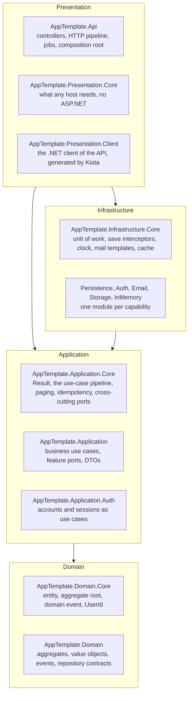

# Architecture

This project is a .NET HTTP API built in four layers. Source dependencies point inward, and the
tests in `tests/Architecture/AT.Architecture.Tests` fail the build when one points the
other way. The pages in this section state the rules every layer, feature and endpoint follows;
none of them can be switched off.

## Four layers and the dependency rule

The diagram is the full shape, drawn with every generation option on. A project this project was
generated without is absent from its solution; the rule holds for whatever remains.

| Layer | Holds | May reference |
|---|---|---|
| Domain | the business model and the invariants that protect it | nothing outside itself |
| Application | use cases, ports, DTOs, validators | the domain |
| Infrastructure | the adapters behind the ports | the application, and its own layer's `.Core` |
| Presentation | hosts: controllers, the HTTP pipeline, jobs, composition | the application and Presentation.Core; the host alone references infrastructure modules |

Every layer has a `.Core` project for mechanisms that know no feature, beside the project or
projects that hold the business. [Layers and projects](layers-and-projects.md) names each one.

## How a request travels

A request first crosses the HTTP pipeline that `UseHttpPipeline()` installs, then authentication and
authorisation. A controller binds it and sends one use case's message through `ISender`.

The use-case pipeline traces the message and refuses it when its validator does; its handler then
loads what it needs through a port, asks the aggregate to change or stages a row through a store, and
commits once through `IUnitOfWork`. Save interceptors flush the
aggregate onto its rows, stamp the audit columns and collect the domain events; once the commit
succeeds, the events reach their consumers in the same process.

The controller turns the `Result` into a response: the body and its `ETag` on success, or a problem
document carrying the error's stable `code` on failure.

## The pages in this section

[The index](index.md) lists the pages of this section, each with the question it answers.

Where each file goes, and what it is called, is [the project layout](../reference/project-layout.md).

## The stack

These are the choices this project stands on. Each could have gone another way; the row gives its
reason in one line and links the page that says what changing it costs: the tests that hold it, the
files that move, the release steps that depend on it. A product decision that overrides a row is an
ADR numbered from 1000, linked in the row's *Changed by* cell, so the table shows at a glance which
choices still hold. What this project was generated without is absent from the table and from the
code, not switched off.

A foundation is judged by what it makes easier later, not by how many endpoints use it today: one
that nothing uses yet stays until someone decides to remove it, and that removal is a decision like
any other.

| Choice | Why, in one line | Described in | Changed by |
|---|---|---|---|
| Clean Architecture in four layers, dependencies pointing inward | What may depend on what is the organising rule; `LayerDependencyTests` hold it | [Four layers](#four-layers-and-the-dependency-rule) | — |
| `Presentation.Core` is host-agnostic: no ASP.NET Core framework reference, no database driver | A CLI, desktop or second API host composes the same use cases; `PortabilityTests` hold it | [Layers and projects](layers-and-projects.md#presentationcore-host-agnostic) | — |
| Foundations ship before a feature uses them: paging, idempotency, outbound HTTP, jobs and leases, cache | A feature codes its business, not its plumbing | [Shared mechanisms](shared-mechanisms.md) | — |
| <!--#if (agentFiles)--> |
| Clean comments: a comment stays only for what the code cannot say (a reason, an outside constraint, a reference) | A comment that restates the code rots the next time anything moves | [AGENTS.md](../../AGENTS.md#changing-code) | — |
| <!--#endif--> |
| <!--#if (!agentFiles)--> |
| Clean comments: a comment stays only for what the code cannot say (a reason, an outside constraint, a reference) | A comment that restates the code rots the next time anything moves | [Contributing](../../CONTRIBUTING.md) | — |
| <!--#endif--> |
| .NET SDK pinned by `global.json`, package versions in `Directory.Packages.props`, warnings as errors, a diagnostic silenced only by a row of the gate's list | One toolchain on every machine and in CI; `SilencedDiagnosticTests` refuses a silence without its row | [Build and CI](../guides/build-and-ci.md#the-gate) | — |
| One solution at the root, `AppTemplate.slnx` | A project added or removed is one line to review and merge, with no GUID to reconcile | [Adding a project](../guides/adding-a-project.md#steps) | — |
| <!--#if (ci)--> |
| Every dependency at an exact version: packages, container images by digest, workflow actions by commit; Dependabot proposes updates in bands and ignores none | A tag or a range moves under you; an ignored dependency is one nobody revisits | [Supply chain](../guides/build-and-ci.md#supply-chain) | — |
| <!--#endif--> |
| <!--#if (api)--> |
| ASP.NET Core MVC controllers, `Asp.Versioning`, `Microsoft.AspNetCore.OpenApi`; Scalar in Development | Attribute-routed controllers carry the conventions; the framework's own generator writes the document | [HTTP API](http-api.md#versioning-and-the-openapi-document) | — |
| <!--#endif--> |
| <!--#if (postgreSql)--> |
| PostgreSQL through EF Core and Npgsql | One relational store with schemas, advisory locks and `xmin` | [Persistence model](persistence-model.md) | — |
| <!--#endif--> |
| <!--#if (sqlServer)--> |
| SQL Server through EF Core | One relational store with schemas, application locks, and a version counter the save stamps | [Persistence model](persistence-model.md) | — |
| <!--#endif--> |
| <!--#if (sqlite)--> |
| SQLite through EF Core, for development | One file, no server to run; a table prefix per feature, in-process locks and a version counter the save stamps | [Persistence model](persistence-model.md#text-and-time) | — |
| <!--#endif--> |
| FluentValidation, run by the use-case pipeline before each handler | A message its validator refuses never reaches its handler, and the validator is testable without a host | [Use cases are messages](domain-and-results.md#use-cases-are-messages) | — |
| <!--#if (localAuth)--> |
| Local accounts on ASP.NET Core Identity: JWT access tokens, rotating refresh tokens | The project is its own identity provider; the mode decides which modules exist | [Authentication](../features/authentication.md) | — |
| <!--#endif--> |
| <!--#if (externalAuth)--> |
| Tokens from an external identity provider, validated by each host | Credentials stay with the provider; the mode decides which modules exist | [Authentication](../features/authentication.md) | — |
| <!--#endif--> |
| <!--#if (publicApi)--> |
| No accounts | Nothing the project serves belongs to a caller; the mode decides which modules exist | [Authentication](../features/authentication.md) | — |
| <!--#endif--> |
| `HybridCache`, in process | A shared second level is one `IDistributedCache` registration away, with no caller changed | [Cache](shared-mechanisms.md#cache) | — |
| <!--#if (api)--> |
| Invariant globalization; the language of an answer is a tag | No ICU in the image; mails are chosen by tag and dates written round-trip | [Language of the answer](request-pipeline.md#language-of-the-answer) | — |
| <!--#endif--> |
| <!--#if (!api)--> |
| Invariant globalization; the language of a mail is a tag | No ICU in the image; mails are chosen by tag and dates written round-trip | [Email](../features/email.md) | — |
| <!--#endif--> |
| OpenTelemetry over OTLP | Vendor-neutral export, the backend chosen per deployment | [Observability](../features/observability.md) | — |
| Mail over SMTP or Postmark, chosen by configuration; Mailpit locally | One transport, chosen once, with no SDK | [Email](../features/email.md) | — |
| <!--#if (files)--> |
| An S3-compatible object store; SeaweedFS locally, from the image its own project publishes | MinIO publishes no image of its own; SeaweedFS passes the storage suite unchanged | [Files](../features/files.md#storage) | — |
| <!--#endif--> |
| Docker Compose for the local stack | One command runs the hosts and their dependencies | [First run](../getting-started/first-run.md#run-with-compose) | — |
| TLS terminates upstream: plain HTTP, no HTTPS redirection, no HSTS; forwarded headers believed only from a named proxy, none named by default | Only the component terminating TLS knows the domain's commitments | [Behind a proxy](../guides/deployment.md#behind-a-proxy) | — |
| No migration ships with the project: `bootstrap` creates each context's initial migration, and the team commits it | A migration written for every shape the project could take is conditioned by hand and drifts; EF writes the first one from this project's model and database | [The initial migration](../guides/migrations.md#the-initial-migration) | — |
| <!--#if (serverDatabase)--> |
| Migrations applied at release: one bundle per context, run by a principal with DDL rights; the hosts migrate in Development only | A process never alters its own schema in production | [Migrations at release](../guides/deployment.md#migrations-at-release) | — |
| <!--#endif--> |
| <!--#if (sqlite)--> |
| The API migrates itself in Development, and refuses to start anywhere else | A SQLite file is a development database; moving to a server one is [generating the project again](../guides/deployment.md#when) | [Migrations](../guides/migrations.md#apply-them) | — |
| <!--#endif--> |
| Host images on alpine, running unprivileged | The healthcheck needs `wget`, which the chiseled images lack | [The image](../guides/deployment.md#the-image) | — |
| <!--#if (anyWeb)--> |
| One pnpm workspace under `src/Web`, Node and pnpm pinned | Apps and packages share one lockfile; nothing in the .NET build needs Node | [Web front end](../features/web-frontend.md) | — |
| <!--#endif--> |
| <!--#if (postgreSql)--> |
| xUnit v3, Shouldly, NSubstitute, Testcontainers, NetArchTest | Integration tests run on a real PostgreSQL; the architecture is held by tests | [Testing](../guides/testing.md) | — |
| <!--#endif--> |
| <!--#if (sqlServer)--> |
| xUnit v3, Shouldly, NSubstitute, Testcontainers, NetArchTest | Integration tests run on a real SQL Server; the architecture is held by tests | [Testing](../guides/testing.md) | — |
| <!--#endif--> |
| <!--#if (sqlite)--> |
| xUnit v3, Shouldly, NSubstitute, NetArchTest | Integration tests run on a real SQLite file; the architecture is held by tests | [Testing](../guides/testing.md) | — |
| <!--#endif--> |
| <!--#if (ci)--> |
| GitHub Actions | The gate runs where the repository lives | [Workflows](../guides/build-and-ci.md#workflows) | — |
| CodeQL code scanning beside the gate, weekly and on every change to `main` | Taint paths a test does not walk, reported where GitHub shows alerts | [Workflows](../guides/build-and-ci.md#workflows) | — |
| <!--#endif--> |
| <!--#if (sonar)--> |
| Sonar for static analysis and coverage | Issues and coverage read in one place, locally as in CI | [Sonar](../guides/build-and-ci.md#sonar) | — |
| <!--#endif--> |
| <!--#if (presentationBlazorServer)--> |
| A Blazor Web App with server interactivity, its pages from `dotnet new blazor` at bootstrap, composing the use cases in process | A server-rendered site needs no client of the API and no token per user | [Presentation projects](../features/presentation.md) | — |
| <!--#endif--> |
| <!--#if (presentationAvalonia)--> |
| An Avalonia desktop app, its views from `dotnet new avalonia.mvvm` at bootstrap, calling the API through the .NET client | A desktop app runs on the user's machine, where only the HTTP contract reaches the use cases | [Presentation projects](../features/presentation.md) | — |
| <!--#endif--> |
| <!--#if (presentationMcp)--> |
| An MCP server in the shape of `dotnet new mcpserver --transport remote`, stateless on Streamable HTTP, each tool one use case called in process | An agent's client reaches the use cases as tools, acting for the caller its credential names | [Presentation projects](../features/presentation.md) | — |
| <!--#endif--> |
| <!--#if (presentationWpf)--> |
| A WPF desktop app for Windows in the shape of `dotnet new wpf`, developed, run and tested on Windows, calling the API through the .NET client | A desktop app runs on the user's machine, where only the HTTP contract reaches the use cases | [Presentation projects](../features/presentation.md) | — |
<!--#endif-->

A row's reason stops holding when the platform moves, when its cost shows up in an incident or a
measurement, or when the team finds itself working around it without having recorded why: that is
when a row is revisited.

## What is deliberately absent

| Not here | Instead | See |
|---|---|---|
| MediatR, a dispatcher resolved at run time | Mediator's source generator writes each host's dispatch at compile time | [ADR 0033](../decisions/0033-use-cases-are-mediator-messages-and-ports-are-explicit.md) |
| A generic repository, `IQueryable` in a port | four words for four ways to reach storage | [Ports and adapters](ports-and-adapters.md#repository-queries-store-table) |
| EF Core mapping the domain types | row records, a mapper and a tracker | [ADR 0005](../decisions/0005-the-domain-is-not-mapped-by-ef.md) |
| Soft delete | `DELETE` removes rows | [ADR 0038](../decisions/0038-deleting-removes-rows.md) |
| An outbox, a message bus | events published in process after the commit, and sweeps that re-derive | [ADR 0006](../decisions/0006-events-after-commit-without-an-outbox.md) |
| AutoMapper, Mapperly | mappings written by hand, checked by the compiler: a mapping that pairs members by name would publish a field with no line in the diff; `BannedPackageTests` refuses both packages | [ADR 0036](../decisions/0036-mappings-are-written-by-hand.md) |
| <!--#if (api)--> |
| Minimal APIs | MVC controllers, which carry the filters, the result mapping and the `ETag` handling | [HTTP API](http-api.md) |
| <!--#endif--> |
| Output caching | revalidation headers on responses, `ICacheStore` for values | [Shared mechanisms](shared-mechanisms.md#cache) |
| An abstraction made for a single case | one extracted only once two real cases prove its shape | [Ports and adapters](ports-and-adapters.md#ports-are-named-for-intent) |
| A `.Core` and a `.<Technology>` project per module | one project per capability | [Modules and boundaries](modules-and-boundaries.md#infrastructure-per-capability) |
| <!--#if (serverDatabase)--> |
| Migrations at start-up outside Development | one bundle per context, applied at release | [Deployment](../guides/deployment.md#migrations-at-release) |
| <!--#endif--> |
| <!--#if (sqlite)--> |
| Running outside Development | SQLite is a development database, and the API refuses to start elsewhere | [ADR 0021](../decisions/0021-sqlite-is-a-development-database.md) |
| <!--#endif--> |
| HTTPS redirection, HSTS | TLS terminates upstream | [Deployment](../guides/deployment.md#behind-a-proxy) |
| <!--#if (accounts)--> |
| <!--#if (api)--> |
| Permissions, tenants | one `Administrator` policy beside the default-deny fallback | [Request pipeline](request-pipeline.md#authorisation) |
| <!--#endif--> |
| <!--#endif--> |
| <!--#if (publicApi)--> |
| <!--#if (api)--> |
| Roles, policies, tenants | every caller is admitted; nothing is owned by a tenant | [Request pipeline](request-pipeline.md#authorisation) |
| <!--#endif--> |
| <!--#endif--> |
| <!--#if (localAuth)--> |
| Machine-to-machine authentication | every token belongs to a person who signed in | [Authentication](../features/authentication.md) |
| <!--#endif--> |
| <!--#if (anyWeb)--> |
| A shared contracts assembly | the web apps use a client generated from the API's OpenAPI document | [ADR 0019](../decisions/0019-one-generated-api-client.md) |
| <!--#endif--> |
| <!--#if (!anyWeb)--> |
| <!--#if (api)--> |
| A client contracts package | a client generates its types from the API's OpenAPI document | [HTTP API](http-api.md#versioning-and-the-openapi-document) |
<!--#endif-->
<!--#endif-->

## Decisions

- [0001. Adopt the generated baseline](../decisions/0001-adopt-the-generated-baseline.md)
- [0002. Two feature shapes](../decisions/0002-two-feature-shapes.md)
- [0033. Use cases are Mediator messages, and ports are explicit](../decisions/0033-use-cases-are-mediator-messages-and-ports-are-explicit.md)
- [0034. Features meet through ports their owner declares, and events](../decisions/0034-features-meet-through-ports-their-owner-declares-and-events.md)
- [0005. The domain is not mapped by EF](../decisions/0005-the-domain-is-not-mapped-by-ef.md)
- [0006. Events after commit without an outbox](../decisions/0006-events-after-commit-without-an-outbox.md)
- [0007. One database, a schema per feature](../decisions/0007-one-database-a-schema-per-feature.md)
- [0008. Optimistic concurrency end to end](../decisions/0008-optimistic-concurrency-end-to-end.md)
<!--#if (accounts)-->
- [0009. Ownership is in the query](../decisions/0009-ownership-is-in-the-query.md)
<!--#endif-->
- [0010. An idempotency key is a lease per user](../decisions/0010-idempotency-key-is-a-lease-per-user.md)
<!--#if (!jobsWorker)-->
- [0011. Jobs run in the API under a lease](../decisions/0011-jobs-run-in-the-api-under-a-lease.md)
<!--#endif-->
<!--#if (sqlite)-->
- [0021. SQLite is a development database](../decisions/0021-sqlite-is-a-development-database.md)
<!--#endif-->
<!--#if (jobsWorker)-->
- [0025. Jobs run in a worker, under a lease](../decisions/0025-jobs-run-in-a-worker-under-a-lease.md)
<!--#endif-->
