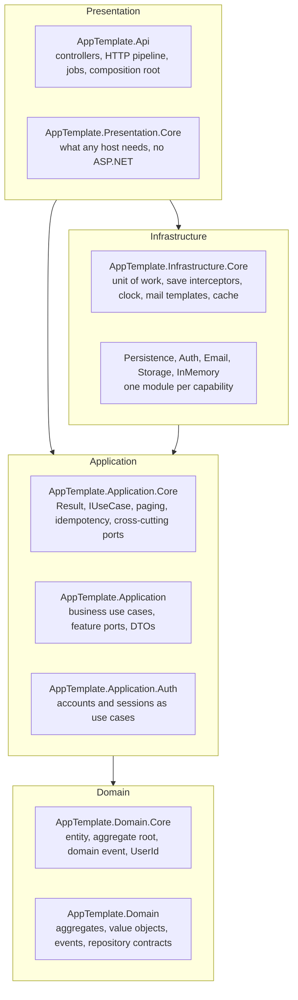

# Architecture

This project is a .NET HTTP API built in four layers. Source dependencies point inward, and the
tests in `Tests/Architecture/AppTemplate.Architecture.Tests` fail the build when one points the
other way. The pages in this section state the rules every layer, feature and endpoint follows;
none of them can be switched off.

## Four layers and the dependency rule

The diagram is the full shape, drawn with every generation option on. A project this project was
generated without is absent from its solution; the rule holds for whatever remains.

| Layer | Holds | May reference |
|---|---|---|
| Domain | the business model and the invariants that protect it | nothing outside itself |
| Application | use cases, ports, DTOs, validators | the domain |
| Infrastructure | the adapters behind the ports | the application, and its own layer's `.Core` |
| Presentation | hosts: controllers, the HTTP pipeline, jobs, composition | the application and Presentation.Core; the host alone references infrastructure modules |

Every layer has a `.Core` project for mechanisms that know no feature, beside the project or
projects that hold the business. [Layers and projects](layers-and-projects.md) names each one.

## How a request travels

A request first crosses the HTTP pipeline that `UseHttpPipeline()` installs, then authentication and
authorisation. A controller binds it and calls one use case through that use case's interface.

The use case validates its input, loads what it needs through a port, asks the aggregate to change
or stages a row through a store, and commits once through `IUnitOfWork`. Save interceptors flush the
aggregate onto its rows, stamp the audit columns and collect the domain events; once the commit
succeeds, the events reach their consumers in the same process.

The controller turns the `Result` into a response: the body and its `ETag` on success, or a problem
document carrying the error's stable `code` on failure.

## The pages in this section

| Page | Answers |
|---|---|
| [Layers and projects](layers-and-projects.md) | Which projects make each layer, and how is the host composed? |
| [Feature shapes](feature-shapes.md) | Should a feature be an aggregate or a service over a store? |
| [Modules and boundaries](modules-and-boundaries.md) | What may a feature or a module depend on? |
| [Ports and adapters](ports-and-adapters.md) | How does the application reach storage and the outside world? |
| [Domain and results](domain-and-results.md) | How are rules enforced, failures reported and facts published? |
| [Persistence model](persistence-model.md) | How is data mapped, saved and protected from lost updates? |
| [Request pipeline](request-pipeline.md) | What happens to every request on its way in and out? |
| [HTTP API](http-api.md) | What contract does every endpoint offer a client? |
| [Shared mechanisms](shared-mechanisms.md) | Which mechanisms can a feature use without writing them? |

Where each file goes, and what it is called, is [the project layout](../reference/project-layout.md).

## What is deliberately absent

| Not here | Instead | See |
|---|---|---|
| MediatR, a dispatcher, pipeline behaviours | a controller calls a use case through its interface | [ADR 0003](../decisions/0003-use-cases-and-ports-are-explicit.md) |
| A generic repository, `IQueryable` in a port | four words for four ways to reach storage | [Ports and adapters](ports-and-adapters.md#repository-queries-store-table) |
| EF Core mapping the domain types | row records, a mapper and a tracker | [ADR 0005](../decisions/0005-the-domain-is-not-mapped-by-ef.md) |
| Soft delete | `DELETE` removes rows | [Persistence model](persistence-model.md#deleting-removes-rows) |
| An outbox, a message bus | events published in process after the commit, and sweeps that re-derive | [ADR 0006](../decisions/0006-events-after-commit-without-an-outbox.md) |
| AutoMapper | mappings written by hand, checked by the compiler | [Layers and projects](layers-and-projects.md#the-api-host) |
| Minimal APIs | MVC controllers, which carry the filters, the result mapping and the `ETag` handling | [HTTP API](http-api.md) |
| Output caching | revalidation headers on responses, `ICacheStore` for values | [Shared mechanisms](shared-mechanisms.md#cache) |
| An abstraction made for a single case | one extracted only once two real cases prove its shape | [Ports and adapters](ports-and-adapters.md#ports-are-named-for-intent) |
| A `.Core` and a `.<Technology>` project per module | one project per capability | [Modules and boundaries](modules-and-boundaries.md#infrastructure-per-capability) |
| Migrations at start-up outside Development | one bundle per context, applied at release | [Deployment](../guides/deployment.md#migrations-at-release) |
| HTTPS redirection, HSTS | TLS terminates upstream | [Deployment](../guides/deployment.md#behind-a-proxy) |
<!--#if (accounts)-->
| Permissions, tenants | one `Administrator` policy beside the default-deny fallback | [Request pipeline](request-pipeline.md#authorisation) |
<!--#endif-->
<!--#if (publicApi)-->
| Roles, policies, tenants | every caller is admitted; nothing is owned by a tenant | [Request pipeline](request-pipeline.md#authorisation) |
<!--#endif-->
<!--#if (localAuth)-->
| Machine-to-machine authentication | every token belongs to a person who signed in | [Authentication](../features/authentication.md) |
<!--#endif-->
<!--#if (anyWeb)-->
| A shared contracts assembly | the web apps use a client generated from the API's OpenAPI document | [ADR 0019](../decisions/0019-one-generated-api-client.md) |
<!--#endif-->
<!--#if (!anyWeb)-->
| A client contracts package | a client generates its types from the API's OpenAPI document | [HTTP API](http-api.md#versioning-and-the-openapi-document) |
<!--#endif-->

## Decisions

- [0001. Adopt the generated baseline](../decisions/0001-adopt-the-generated-baseline.md)
- [0002. Two feature shapes](../decisions/0002-two-feature-shapes.md)
- [0003. Use cases and ports are explicit](../decisions/0003-use-cases-and-ports-are-explicit.md)
- [0004. Features meet through ports and events](../decisions/0004-features-meet-through-ports-and-events.md)
- [0005. The domain is not mapped by EF](../decisions/0005-the-domain-is-not-mapped-by-ef.md)
- [0006. Events after commit without an outbox](../decisions/0006-events-after-commit-without-an-outbox.md)
- [0007. One database, a schema per feature](../decisions/0007-one-database-a-schema-per-feature.md)
- [0008. Optimistic concurrency end to end](../decisions/0008-optimistic-concurrency-end-to-end.md)
<!--#if (accounts)-->
- [0009. Ownership is in the query](../decisions/0009-ownership-is-in-the-query.md)
<!--#endif-->
- [0010. Idempotency-Key is a lease per user](../decisions/0010-idempotency-key-is-a-lease-per-user.md)
- [0011. Jobs run in the API under a lease](../decisions/0011-jobs-run-in-the-api-under-a-lease.md)
